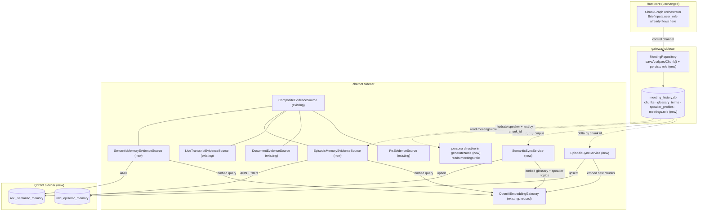

# Meeting Semantic Memory
**Architecture plan · Roxi AI — Agent Memory**

A four-layer agent-memory architecture — working, episodic, semantic, procedural — for Roxi's live transcription, grounded in the memory-stream model from Park et al.'s *Generative Agents* and mapped field-by-field onto the existing hybrid retrieval stack.

- **Episodic** — chunk embeddings + recency/importance re-ranking
- **Semantic** — unused glossary & speaker knowledge, wired in
- **Procedural** — meeting role persisted & injected into answers
- **Working** — already implemented — documented, not rebuilt

## Table of contents
1. [Decisions on record](#01--decisions-on-record)
2. [The memory model](#02--the-memory-model)
3. [Current retrieval stack](#03--current-retrieval-stack)
4. [Target architecture](#04--target-architecture)
5. [Episodic memory](#05--episodic-memory--metadata--scoring)
6. [Semantic memory](#06--semantic-memory--glossary--speaker-knowledge)
7. [Modern voice-ID upgrade](#07--modern-voice-id-upgrade)
8. [Procedural memory](#08--procedural-memory--role--persona)
9. [Write path](#09--write-path--how-a-live-chunk-becomes-a-vector)
10. [Read path](#10--read-path--two-new-evidence-sources)
11. [Qdrant collection design](#11--qdrant-collection-design)
12. [Packaging as a sidecar](#12--packaging-qdrant-as-a-local-sidecar)
13. [Config reference](#13--config-reference)
14. [Cost & budget](#14--cost--budget)
15. [Failure modes](#15--failure-modes--degradation)
16. [Testing plan](#16--testing-plan)
17. [Rollout phases](#17--rollout-phases)
18. [Open questions](#18--open-questions)

---

## 01 — Decisions on record

Two calls were made up front, in an earlier pass of this plan, because they change the shape of everything downstream. A correction is folded into the second one below — later research surfaced that the original justification named the wrong table.

**Q: Where do vectors live?**
**A: A separate vector database — Qdrant.**
> Not `sqlite-vec`, and not the brute-force `Float32`-BLOB scan `DocumentRepositorySqlite` already uses for uploaded documents. That scan is documented as fine "past ~50k chunks, revisit" — live meetings compound daily and a single long program will cross that line. Qdrant also gives payload-indexed filtering (by meeting, project, speaker, significance) that a brute-force scan would otherwise have to reimplement by hand.

**Q: What gets embedded, for episodic recall?**
**A: `chunks`, not `transcripts` — and still not decisions, risks, action items, or replies.**
> **Correction from the first draft:** that draft claimed chunks were "the retrieval unit the chatbot already fans out to." Checking `SqliteMeetingStore.js`'s `SOURCES` list shows the existing FTS index actually runs over `transcripts` (raw STT turns) — `chunks` is never lexically indexed today. This plan still chooses to embed `chunks`, deliberately: it is the ChunkGraph's *analyzed* output — carrying `significance` and `topic`, and FK-linked to decisions/risks/action items — which is exactly the enrichment a memory layer needs and raw transcripts lack. The result is an intentional asymmetry: lexical recall stays maximal over every raw word ever spoken; episodic recall runs one layer up, over the analyzed chunk.

---

## 02 — The memory model

The taxonomy below is standard in the agent-memory literature — temporal (short- vs. long-lived) crossed with cognitive (what kind of content). Mapped onto Roxi, three of the four layers already exist in some form; this plan's job is to make each one deliberate and give it a metadata schema, not to invent a new architecture from scratch.

| Layer | Definition | Status |
|---|---|---|
| **Working memory** | Active scratchpad for the current turn — resets when the session ends. | **Already built.** The LangGraph `state.js` per thread, plus `LiveTranscriptEvidenceSource`'s rolling buffer of the meeting in progress. No embedding call — keyword overlap is enough for "what did we just say." |
| **Episodic memory** | Specific past events, tied to a timeline — what was said, when, by whom. | **This plan's primary build.** Each `chunks` row, embedded with meeting/time/speaker/significance metadata and re-ranked by recency + importance before fusion. §05. |
| **Semantic memory** | Durable facts and vocabulary that hold regardless of which meeting they came from. | **Already captured, never used.** `glossary_terms` and `speaker_profiles.topics` are written by the live pipeline every session and read by nothing — zero references anywhere in `chatbot/src`. §06. |
| **Procedural memory** | Rules for how the agent should behave — tone, audience, protocol — not facts about the world. | **Half-built.** `user_role` ("Technical Lead," "Executive"…) already shapes every live agent's tone via `BriefInputs` — but it is never written to `meeting_history.db`, so it vanishes the moment the meeting ends. §07. |

> **Where the scoring model below comes from.** Park et al., *Generative Agents: Interactive Simulacra of Human Behavior* (arXiv:2304.03442), score each candidate memory as a weighted blend of **relevance** (embedding cosine similarity), **recency** (exponential decay since last access), and **importance** (an LLM-rated poignancy score, 1–10), then retrieve the top-scoring memories for the agent's current context. Roxi already computes something equivalent to the importance term for free — the `ContextManagerAgent`'s `significance` field (low/medium/high) — so §05 adapts the paper's formula to a fixed-weight blend over a 3-level categorical signal rather than a continuous LLM-rated one, and swaps "since last accessed" for "since spoken," which is the more meaningful clock for a meeting transcript.

---

## 03 — Current retrieval stack

This is not a greenfield build. The chatbot already runs a hybrid, multi-source retrieval graph — semantic search over uploaded documents included. The job here is to add evidence sources in the shape the existing ones already establish.

| Source | Class | Method | Status |
|---|---|---|---|
| Raw transcripts (lexical) | `FtsEvidenceSource` | FTS5 BM25 over `chat_index.db` | existing |
| Uploaded documents (semantic) | `DocumentEvidenceSource` | OpenAI embed → cosine scan over `doc_store.db` | existing |
| Live buffer (current meeting) | `LiveTranscriptEvidenceSource` | keyword overlap, no embedding call | existing |
| Analyzed chunks (episodic) | `EpisodicMemoryEvidenceSource` | OpenAI embed → Qdrant ANN + recency/importance rerank | **new · §05** |
| Glossary & speaker knowledge (semantic) | `SemanticMemoryEvidenceSource` | OpenAI embed → Qdrant ANN, no recency decay | **new · §06** |

All five are meant to sit behind one `CompositeEvidenceSource`, which already fans a query out to every registered source concurrently and merges the ranked lists with Reciprocal Rank Fusion (`rrf.js`, k=60) — its own doc comment anticipates exactly this: *"Adding a fourth source later — Slack, Jira, Notion — is a new adapter registered in the composition root; this class and retrieveNode never change again."* That promise is what makes this additive rather than invasive.

> **Why hybrid, not a swap.** BM25 stays. Lexical match is still what wins on names, error codes, ticket numbers and exact phrases; vector search is what wins on "what did we decide about pricing" when the word "pricing" never got said out loud. RRF is designed precisely so neither has to be disabled for the other to help.

---

## 04 — Target architecture

One new process (Qdrant, local-only), two new evidence sources in the chatbot, one small migration, two new lines in the composition root.



---

## 05 — Episodic memory — metadata & scoring

Every point in Qdrant's `roxi_episodic_memory` collection carries a payload doing three jobs at once: **filtering** (scope to a meeting/project/speaker before ranking), **provenance** (know which model embedded it, so an upgrade is detectable, not silent), and **citation** (enough to point a user back at the source line).

| Field | Type | Indexed | Purpose |
|---|---|---|---|
| `id` | int (point id) | — | Set equal to `chunks.id`. Globally unique, autoincrement — re-embedding the same id overwrites in place instead of duplicating. |
| `schema_version` | int | no | Payload shape version. Bump when a field is added/renamed so old points can be migrated rather than silently misread. |
| `embed_model` / `embed_dims` | keyword / int | yes / no | e.g. `text-embedding-3-small`, 1536. Detects a model or width change the same way `OpenAiEmbeddingGateway` already guards documents against. |
| `source_table` | keyword | yes | Constant `"chunks"`. Reserved so a future collection holding multiple corpora coexists without an id collision. |
| `meeting_id` / `project_id` | int / int\|null | yes / yes | FK scoping — mirrors how `documents.project_id` already scopes uploads. |
| `display_id` | keyword | no | e.g. `ROXI-041` — the human identity shown in a citation, not the surrogate key. |
| `chunk_seq` | int | no | Order within the meeting — lets a hit expand to "show surrounding context" with no text search. |
| `speaker` | keyword | yes | **Filter-only, not source of truth.** `rename_speaker` can change a display name after the fact; the real name is re-resolved at query time (§09). |
| `topic` | keyword \| null | yes | From `ContextManagerAgent`. Coarse filter, e.g. "only chunks tagged pricing." |
| `significance` | keyword | yes | `low` / `medium` / `high` — filterable form of the importance signal. |
| `importance` | float [0,1] | no | **New, derived at sync time** from `significance` (0.3 / 0.6 / 1.0). The numeric form the scoring formula below actually uses. |
| `linked_decision_ids` / `linked_risk_ids` / `linked_action_item_ids` | int[] | no | **New.** Populated by joining `decisions`/`risks`/`action_items` on `chunk_id` at sync time. Lets a hit's citation say "this led to a decision" without a second query. |
| `meeting_context` | text (≤300 chars) | no | The user's own meeting briefing. Gives the embedding a scrap of situating context beyond the bare line. |
| `meeting_start_time` / `created_at` | datetime (RFC3339) | yes (range) / no | Range filters ("meetings from last week") and the recency term below. |
| `char_count` | int | no | Length of the embedded text — cheap filter for near-empty chunks. |

> **What is deliberately NOT in the payload.** The verbatim chunk `text`, for the same reason `speaker` is filter-only: Qdrant is not the source of truth for anything a user reads. Text is re-fetched from `meeting_history.db` by `chunk_id` at query time.

> **Why share the embedding model with documents.** Keeps a real option open cheaply: a unified semantic index across meetings + documents later needs only a new `source_table` value and a shared merge — not a re-embed of one corpus to match the other's vector space.

### Recency + importance re-ranking

Cosine similarity alone treats a throwaway line from an hour ago the same as a high-significance decision from three weeks ago that happens to phrase things slightly differently. Before `EpisodicMemoryEvidenceSource` hands its ranked list to `CompositeEvidenceSource` for RRF fusion, it re-sorts its own hits by a composite score — the Park et al. blend, adapted to Roxi's actual signals:

```
score = 0.60 · relevance + 0.25 · importance + 0.15 · recency

relevance = cosine similarity
importance = significance mapped to {0.3, 0.6, 1.0}
recency = exp(-ln(2) · Δdays / 14)
```

Relevance still dominates — this is a re-rank within an already similarity-filtered set, not a replacement for semantic match. A 14-day recency half-life reflects how meetings get recalled in practice (weeks, not the hours Park et al.'s simulated agents operate on); all three weights and the half-life are tunable constants, not hardcoded (§13).

```js
function compositeScore(hit, now) {
  const relevance = hit.similarity;                       // already ∈ [0,1], cosine
  const importance = hit.payload.importance;               // 0.3 | 0.6 | 1.0
  const ageDays = (now - Date.parse(hit.payload.created_at)) / 86_400_000;
  const recency = Math.exp(-Math.LN2 * ageDays / RECENCY_HALFLIFE_DAYS);
  return W_RELEVANCE * relevance + W_IMPORTANCE * importance + W_RECENCY * recency;
}
```

---

## 06 — Semantic memory — glossary & speaker knowledge

This is the concrete answer to "which memory is good for this project" — the highest-leverage, lowest-cost layer, because the data already exists and is already being written by the live pipeline. Nothing in `chatbot/src` reads `glossary_terms` or `speaker_profiles` today; a grep across the whole chatbot source returns zero hits for either.

**Glossary terms — primary win.** Written by `upsertGlossary` every time `ContextManagerAgent` surfaces a term + definition. Schema-wise it's per-meeting (`PRIMARY KEY (meeting_id, term)`), but a term's *meaning* is durable across meetings — so the sync job groups by `LOWER(term)` across all meetings, keeps the most recent definition, and embeds **one point per distinct term** with a `meeting_ids: int[]` provenance array. No schema migration required — this is a smarter query, not a new column.

**Speaker topics — held back.** `speaker_profiles.topics` answers "what does this person usually discuss" — but only as well as cross-meeting voice matching works, and that turns out to be a real constraint, not a formality. `diarization-layer.js` matches voices from ~1 second of audio (`MIN_CHUNKS_FOR_EMBEDDING = 4`) reduced to a 13-number MFCC fingerprint — a lightweight, decades-old technique, not a modern speaker-embedding model — against a 0.85 cosine-similarity bar. Below that bar it does nothing (falls back to the raw "Speaker A" label) rather than guessing, which is the reassuring part: **the failure mode is a fragmented history (some sessions unmatched), not a contaminated one (never attributes to the wrong person)**. The unresolved part: `gateway/test/diarization.test.js` only exercises the matching logic against a fake, deterministic fingerprint — nothing in this codebase measures the real match rate on actual audio. **Recommendation: hold this layer back** until basic production logging of the real match/miss rate exists — building a memory feature on an unmeasured foundation is a second guess stacked on a first one. §07 is the concrete upgrade path for that foundation.

| Field | Type | Notes |
|---|---|---|
| `id` | string (hash) | `sha1("glossary:" + lower(term))` — deterministic, so re-syncing the same term always overwrites the same point. |
| `source_table` | keyword | `"glossary_term"` or `"speaker_topic"` — the two kinds this collection holds. |
| `term` / `definition` | keyword / text | The embedded content is `"{term}: {definition}"` — definitions alone are often too short to embed meaningfully on their own. |
| `meeting_ids` | int[] | Every meeting this term was seen in — provenance, and lets a citation say "first defined in ROXI-012." |
| `project_id` | int \| null | Populated only when every contributing meeting shares one project; `null` (unscoped) otherwise — a term shouldn't look project-scoped from one stray mention. |
| `last_seen` | datetime | No recency decay is applied at query time here (semantic memory is timeless by definition) — kept only for display and staleness auditing. |

> **No recency term, on purpose.** This is the one place the episodic scoring formula above does *not* apply. A glossary definition doesn't get less true because it's old — that is the entire distinction the taxonomy draws between episodic and semantic memory, and the metadata design has to honor it rather than applying one formula everywhere out of convenience.

---

## 07 — Modern voice-ID upgrade

This section answers directly: can the weak link found in §06 — the homegrown MFCC cross-session voice matcher — be replaced with a modern deep-learning voice-ID model, and what would that take on this stack specifically, given AssemblyAI is the current STT/diarization provider.

> **First, a correction: "100% accuracy" is not an engineering target.** No production speaker-identification system, at any company, claims 100% — voice is not a fingerprint. Colds, fatigue, phones/headsets, room echo, and two people who simply sound alike all move the numbers. The metric the field actually uses is **Equal Error Rate (EER)** — the point where "wrongly says two different people are the same" (false accept) and "wrongly says the same person is different" (false reject) cross over. State-of-the-art models score roughly **0.5–1% EER** on clean benchmark recordings (VoxCeleb); realistic in-the-wild meeting audio — mixed mics, cross-talk, room noise — typically runs several points higher. The honest, achievable goal here is: move from an unmeasured, ad-hoc 13-number heuristic to a modern, *measured*, industry-standard model with a calibrated, monitored threshold — a large, real jump in reliability, stated without overclaiming perfection.

### What's already good, and what actually needs replacing

These are two different problems, and only one of them is weak. Checking `gateway/providers/assemblyai.js` confirms the streaming session is opened with `speakerLabels: true`, and every turn's `"Speaker A"`/`"Speaker B"` label comes straight from AssemblyAI's own acoustic diarization model.

- **Already solid — leave alone.** **Within-meeting diarization** ("who is talking right now, in this call") is AssemblyAI's job, and it's already a modern, trained model — not something this project rolls itself. There is no case for replacing it.
- **Actually weak — this is what to replace.** **Cross-session voice re-identification** ("is today's Speaker A the same person as last Tuesday's Alice") is a separate problem AssemblyAI doesn't solve at all — each streaming session is its own world to it. Roxi's own `diarization-layer.js` + `infrastructure/mfcc.js` was built for exactly this gap, using 1990s-era signal processing, not a trained model.

### The replacement: an ONNX speaker-embedding model, run locally

Not a cloud speaker-ID API (Azure/Pindrop-style services) — this app is local-first everywhere else (audio capture, SQLite, even the vector store in this same plan runs as a local sidecar), and sending voice biometrics off-device would be the one glaring exception. The fit here is a small, pretrained, open-source model exported to **ONNX** and run in-process via `onnxruntime-node`: no Python runtime, no GPU requirement, no network call — a native Node dependency, exactly like every other piece of this pipeline.

| Choice | Why |
|---|---|
| Model: **WeSpeaker CAM++** (or ResNet34), ONNX export | WeSpeaker publishes production-oriented ONNX exports specifically for embedded deployment (this exact use case), trained on VoxCeleb2 + CnCeleb — hundreds of thousands of real speakers, versus Roxi's current model having seen zero. ~20–30 MB on disk. ECAPA-TDNN (SpeechBrain), converted to ONNX once as a build step, is a well-validated fallback if CAM++ underperforms in testing. |
| Runtime: `onnxruntime-node` | Pure native Node addon, no Python. Bundled the same way the Qdrant binary is (§12) — a resource shipped inside the signed `.app`, not a runtime download. |
| Embedding size: 192–256 dims | Versus MFCC's 13 — an order of magnitude more discriminative representation of a voice, from a model that was actually trained to separate speakers rather than just describe spectral shape. |
| Input: still 16kHz mono PCM | `resample.rs` already produces exactly this — no new audio preprocessing pipeline required. |

### Why this is a drop-in, not a rewrite

`DiarizationLayer` already takes its feature extractor as an injected dependency — `constructor(speakerRepository, mfccExtractor)` — and only ever calls two methods on it: `extractMFCC(pcm)` and `cosineSimilarity(a, b)`. That seam already exists; it was never exercised with a second implementation until now. The entire wiring change is one line:

```js
// gateway/sidecar.js:17-68 — before
const mfcc = require('./infrastructure/mfcc.js');
// ...
const diarization = new DiarizationLayer(session.speakers, mfcc);

// after — same shape, new implementation behind it
const voiceId = require('./infrastructure/voice-embedding.js'); // new module
// ...
const diarization = new DiarizationLayer(session.speakers, voiceId);
```

The new module exposes the identical two-method shape MFCC already does, so `diarization-layer.js` itself needs zero changes:

```js
// gateway/infrastructure/voice-embedding.js
const ort = require('onnxruntime-node');
let session = null; // loaded once, reused every call

async function extractEmbedding(pcm16) {  // same signature as extractMFCC
  session ??= await ort.InferenceSession.create(MODEL_PATH);
  const input = preprocessToLogMel(pcm16);           // same 16kHz mono input
  const { embedding } = await session.run({ input }); // 192/256-dim Float32Array
  return normalize(embedding.data);                    // L2-normalize, same
}                                                       // convention as OpenAiEmbeddingGateway

function cosineSimilarity(a, b) { /* identical dot-product formula already in mfcc.js */ }

module.exports = { extractMFCC: extractEmbedding, cosineSimilarity }; // same export shape
```

### What has to change alongside the swap

| Change | Why it's necessary |
|---|---|
| Re-threshold, don't reuse 0.85 | 0.85 was tuned (really: guessed) for a 13-dim MFCC vector's similarity distribution. A 192-dim trained embedding has a completely different similarity distribution — the threshold must be recalibrated against real recordings using an EER sweep, not carried over as a number. |
| Symmetric logging of every match *attempt* | Today, `diarization-layer.js` only logs on a successful match (`voice_matched`). Add a log line on every attempt — matched or not, with the best similarity score seen — so the real match/miss rate becomes computable from logs, closing exactly the measurement gap flagged in §06. |
| Old embeddings can't be compared to new ones | A 13-dim MFCC vector and a 256-dim learned embedding are not the same space — cosine similarity between them is meaningless. `speaker_embeddings` needs an `embed_model` provenance column (the exact same pattern already used for Qdrant payloads in §05/§06) so old rows are recognized as stale and excluded from matching rather than silently compared against. |
| Slightly longer minimum audio | Raise `MIN_CHUNKS_FOR_EMBEDDING` from ~1s to ~2–3s. Still short, but modern embedding models are markedly more reliable with a bit more signal, and the accuracy gain here is nearly free compared to what the model swap itself buys. |

### Migration steps

1. **Ship both, compare offline first.** Run the new model alongside the old one (log both scores, act on neither) across real captured meetings for a trial period — this is how the EER threshold gets calibrated against this project's actual audio conditions, not a benchmark dataset's.
2. **Cut over** once the new model's logged match rate at its calibrated threshold clears a bar the old one never had: an explicit, measured number instead of "seems fine."
3. **Re-enroll, don't migrate, old voices.** Existing `speaker_embeddings` rows are tagged with their model provenance and left in place, unused for new matching — a returning speaker gets re-recognized (or renamed once) under the new model rather than the two vector spaces ever being compared.
4. **Only then** revisit speaker-topic semantic memory (§06) — this section is the prerequisite that section named, not a separate initiative.

> **Footprint.** A 20–30 MB model file (one more bundled resource, same story as Qdrant in §12) and single-digit milliseconds of CPU inference per turn — this runs happily on a laptop CPU with no GPU dependency; embedding a few seconds of speech is a much smaller job than the STT transcription already happening on every turn.

---

## 08 — Procedural memory — role & persona

The intake screen asks "who are you in this meeting?" (Project Manager, Technical Lead, Client/Stakeholder, Designer, Executive). That answer already reaches `BriefInputs.user_role` in Rust and is compiled into the frozen system-prompt prefix every live agent shares for the session — `agents/brief/compiler.rs:60` folds it in right alongside the free-text meeting context. It works, live. It just doesn't survive the meeting ending.

> **The gap.** `meetings` has a `context` column (M001) but no `role` column. The chatbot reads `meeting_history.db` read-only, after the fact — it has no way to know an Executive asked the questions in this meeting versus a Technical Lead, so `generateNode` answers every historical question in one undifferentiated voice, even though the live pipeline already proved role-aware framing works.

### Fix — one column, one prompt block

```js
// gateway/db/migrate.js — new forward-only migration, same shape as M008
{
  version: 9,
  description: 'M009 persist meeting role for post-hoc persona framing',
  statements: ['ALTER TABLE meetings ADD COLUMN role TEXT'],
}

// gateway/db/meeting-repository.js — MeetingRepository.start() insert gains one column
'INSERT INTO meetings (context, role, project_id, project_seq, display_id) VALUES (?, ?, ?, ?, ?)'
```

On the chatbot side, `generateNode` reads the active meeting's `role` (when the question is scoped to one meeting) and adds one short directive to the system prompt — not a second tone taxonomy re-invented in Node, just the same signal already proven live:

```js
if (meeting?.role) {
  systemPrompt += `\n\nThe person who ran this meeting was acting as: ${meeting.role}.
Match your answer's depth and framing to that audience — the same courtesy
the live pipeline already extends during capture.`;
}
```

> **Why this is procedural, not semantic, memory.** Nothing here is a fact retrieved by similarity search — it's a rule about *how to answer*, applied unconditionally whenever it's present. That is precisely the procedural/semantic boundary the taxonomy draws, and it is why this layer needs no embeddings, no Qdrant collection, and no evidence source at all.

---

## 09 — Write path — how a live chunk becomes a vector

The gateway sidecar writes each analyzed chunk to `meeting_history.db` synchronously, inside `MeetingRepository.saveAnalyzedChunk()`, the moment the Rust `ChunkGraph` hands artifacts back over the control channel. That write must stay untouched and un-blocked — embedding is a network round trip and the live capture pipeline cannot wait on it. Two candidate designs for the episodic sync, compared honestly:

**Path A — Incremental pull sync** *(recommended · ships first)*
- Chatbot tracks a high-water mark: `max(chunks.id)` already embedded, stored in `chat_index.db`'s existing `index_meta` table.
- On sidecar startup and on a staleness timer, it reads only chunks newer than the mark, embeds in batches, upserts to Qdrant.
- Mirrors `FtsIndexBuilder.rebuildIfStale()` exactly — same pattern, same protocol shape (`RebuildIndex` → `SyncVectors`).
- Zero changes to gateway, Rust, or the sidecar spawn lifecycle.

**Path B — Real-time push** *(stretch · later phase)*
- Gateway emits a new stdout event after every persisted chunk; Rust's `event_router.rs` forwards it to the chatbot sidecar over the existing stdio JSON channel.
- Sub-second embed latency — genuinely "live."
- Requires the chatbot sidecar to be **kept alive for the whole capture**, not spawned lazily on first "Ask Roxi" as it is today.

> **Why A is the default, not a compromise.** `LiveTranscriptEvidenceSource` already exists to cover exactly this gap for lexical search, with no embedding call. The same answer applies to semantic search: accept a bounded staleness window for the ANN index, and let the live buffer carry the truly-just-said lines.

> **How low the interval can go — resolved.** **1 minute**, not 5. This is a polling design, so the floor is set by how often there's actually anything new to find, not by cost: analyzed chunks themselves don't arrive faster than roughly every 30–60 seconds (STT finalize → ChunkGraph analysis takes real time), so polling much faster than that mostly finds nothing. Going shorter than ~1 minute stops buying freshness and starts being pure overhead — at that point the right move is Path B (push), not a tighter timer on Path A.

The semantic-memory sync (§06) is cheaper still: `glossary_terms` and `speaker_profiles` are tiny relative to `chunks`, so it can afford a full `DELETE + re-insert` rebuild each cycle — the same idempotent-rebuild shape `FtsIndexBuilder.rebuild()` already uses — rather than tracking its own high-water mark.

### New use case — `SyncEpisodicMemoryUseCase`

```js
class SyncEpisodicMemoryUseCase {
  constructor({ meetingStore, embeddings, vectorIndex, syncState, logger }) {}

  async execute({ force = false } = {}) {
    const since = force ? 0 : this.syncState.getHighWaterMark();
    const pending = this.meetingStore.chunksSince(since); // id > since, ORDER BY id
    if (pending.length === 0) return { embedded: 0 };

    let embedded = 0;
    for (let i = 0; i < pending.length; i += EMBED_BATCH) {
      const slice = pending.slice(i, i + EMBED_BATCH);
      const vectors = await this.embeddings.embedBatch(
        slice.map(c => c.text), { tag: 'embed_chunk' }
      );
      await this.vectorIndex.upsertBatch(slice.map((c, j) => ({
        id: c.id, vector: vectors[j], payload: toEpisodicPayload(c),
      })));
      embedded += slice.length;
      this.syncState.setHighWaterMark(slice.at(-1).id);
    }
    return { embedded };
  }
}
```

---

## 10 — Read path — two new evidence sources

Same contract every existing source already honors: `{ name, search(query) }` returning `EvidenceHit[]`. Registered in `container.js` alongside the other three — nothing in `retrieveNode`, `CompositeEvidenceSource`, or `rrf.js` changes.

```js
class EpisodicMemoryEvidenceSource {
  constructor({ vectorIndex, embeddings, meetingStore, logger, minSimilarity = MIN_COSINE_SIMILARITY }) {
    this.name = 'episodic_memory';
  }

  async search({ question, limit = 24, projectId = null, meetingId = null } = {}) {
    if (!question?.trim()) return [];

    const vector = await this.embeddings.embedOne(question, { tag: 'embed_query' });
    const rawHits = await this.vectorIndex.search(vector, {
      limit, minSimilarity: this.minSimilarity,
      filter: { projectId, meetingId }, // pushed down to Qdrant, not applied after
    });
    if (rawHits.length === 0) return [];

    const now = Date.now();
    const reranked = rawHits
      .map(h => ({ ...h, score: compositeScore(h, now) }))
      .sort((a, b) => b.score - a.score);

    // Hydrate current speaker + verbatim text — Qdrant's payload is filter
    // metadata, never the citation source of truth.
    const rows = this.meetingStore.chunksByIds(reranked.map(h => h.id));
    const byId = new Map(rows.map(r => [r.id, r]));

    return reranked
      .map(h => ({ ...h, row: byId.get(h.id) }))
      .filter(h => h.row)
      .map(h => ({
        sourceType: 'meeting',
        groupKey: `meeting:${h.row.meeting_id}`,
        sourceTable: 'chunks',
        sourceId: h.id,
        meetingId: h.row.meeting_id,
        meetingDate: h.row.meeting_start_time,
        speaker: h.row.speaker,
        text: h.row.text,
        score: h.score,
        linkedDecisionIds: h.payload.linked_decision_ids,
      }));
  }
}
```

Note `groupKey`: `meeting:{id}`, identical to `FtsEvidenceSource`'s. A chunk found both lexically and semantically collapses to one RRF entry with contributions from both ranks — exactly the case RRF rewards. `SemanticMemoryEvidenceSource` follows the identical shape with `groupKey = "glossary:" + term` and no recency term in its internal sort.

### Composition root diff

```js
const evidenceSource = new CompositeEvidenceSource({
  sources: [
    new FtsEvidenceSource(retriever, logger),
    new DocumentEvidenceSource({ documents, embeddings, logger }),
    new LiveTranscriptEvidenceSource(),
    new EpisodicMemoryEvidenceSource({ vectorIndex: episodicIndex, embeddings, meetingStore: store, logger }), // + new
    new SemanticMemoryEvidenceSource({ vectorIndex: semanticIndex, embeddings, logger }),                       // + new
  ],
  logger,
});
```

---

## 11 — Qdrant collection design

```
PUT /collections/roxi_episodic_memory
{ "vectors": { "size": 1536, "distance": "Cosine" },
  "hnsw_config": { "m": 16, "ef_construct": 128 } }
PUT /collections/roxi_episodic_memory/index
{ "field_name": "meeting_id", "field_schema": "integer" }
{ "field_name": "project_id", "field_schema": "integer" }
{ "field_name": "speaker", "field_schema": "keyword" }
{ "field_name": "significance", "field_schema": "keyword" }
{ "field_name": "meeting_start_time", "field_schema": "datetime" }

PUT /collections/roxi_semantic_memory
{ "vectors": { "size": 1536, "distance": "Cosine" },
  "hnsw_config": { "m": 16, "ef_construct": 128 } }
PUT /collections/roxi_semantic_memory/index
{ "field_name": "source_table", "field_schema": "keyword" }
{ "field_name": "project_id", "field_schema": "integer" }
```

| Choice | Rationale |
|---|---|
| Two collections, not one | Different lifecycles: episodic grows every meeting and is synced incrementally; semantic is small and fully rebuilt. Separating them means a semantic rebuild can never accidentally touch episodic points, and each can be reindexed independently. |
| Distance = Cosine | Matches the L2-normalization `OpenAiEmbeddingGateway.normalize()` already guarantees. |
| Project scoping via payload filter | Not a physical partition — matches how `documents.project_id` already scopes without per-project tables. |
| HNSW, default params | Thousands, not tens of millions, of vectors for a single-user desktop app — tuning `m`/`ef_construct` is premature. |

---

## 12 — Packaging Qdrant as a local sidecar

This is a desktop app, not a server. "Add a vector database" cannot mean "the user installs Docker." Qdrant ships as a single static binary per platform, which is exactly the shape the app already spawns two of.

- **Rust side.** A new `adapters/vector_client.rs`, mirroring `gateway_client.rs`: spawns the bundled `qdrant` binary bound to `127.0.0.1` only, `--storage-dir` in the app's data directory. Started once in `lib.rs`'s `setup()`, not per capture.
- **Build side.** Binary fetched per-target-arch at build time, included as a Tauri `externalBin` resource — the same mechanism already available for bundling sidecar executables into a signed `.app`/`.dmg`.

> **Real cost of this choice.** Another executable to code-sign, notarize, and keep patched — roughly 40–60 MB added to the installer. Already weighed against `sqlite-vec` in §01; named here so it isn't a packaging-day surprise.

---

## 13 — Config reference

| Variable | Default | Notes |
|---|---|---|
| `QDRANT_URL` | `http://127.0.0.1:6333` | Local-only; never exposed off-loopback. |
| `QDRANT_EPISODIC_COLLECTION` | `roxi_episodic_memory` | §05. |
| `QDRANT_SEMANTIC_COLLECTION` | `roxi_semantic_memory` | §06. |
| `CHATBOT_EPISODIC_SYNC_MAX_AGE_MS` | `60000` (1 min) | The practical floor for a polling design — analyzed chunks rarely arrive faster than this anyway. Below it, switch to push (Phase 7) instead of tightening further. |
| `CHATBOT_SEMANTIC_SYNC_MAX_AGE_MS` | `1800000` (30 min) | Matches `CHATBOT_INDEX_MAX_AGE_MS` — glossary terms change slowly. |
| `EPISODIC_RECENCY_HALFLIFE_DAYS` | `14` | §05 scoring formula. |
| `EPISODIC_W_RELEVANCE` / `_IMPORTANCE` / `_RECENCY` | `0.60` / `0.25` / `0.15` | §05 scoring weights — tunable, not hardcoded. |
| `CHATBOT_EMBED_MODEL` | `text-embedding-3-small` (reused) | Already exists for documents; shared across all layers. |

---

## 14 — Cost & budget

**Per meeting, worked example:** ≈500 chunks · ≈70 tokens/chunk ≈ 35,000 tokens, at $0.02/1M tokens → **≈$0.0007/meeting** episodic. Semantic sync (glossary + topics) is smaller still and runs on a 30-min cycle, not per-meeting.

**Budget guard:** Both sync jobs route through the existing `embedBudget` `CallCountBudgetGuard` — one more consumer of a budget that already exists, not a new guard.

---

## 15 — Failure modes & degradation

| Failure | Behavior |
|---|---|
| Qdrant sidecar not running | Both new sources throw; `CompositeEvidenceSource` already catches per-source failures and degrades to FTS + documents + live buffer — the exact path `DocumentEvidenceSource` already relies on. |
| Embed budget exhausted mid-sync | High-water mark only advances past successfully embedded chunks — the next sync resumes cleanly, nothing lost or duplicated. |
| Meeting has no `role` (pre-migration data) | `generateNode`'s persona block is skipped entirely (§08's `if (meeting?.role)`) — old meetings just answer in the undifferentiated voice they always have. |
| Model dimension change (provider upgrade) | Caught the same way `OpenAiEmbeddingGateway` already catches it for documents — a width mismatch requires a deliberate re-embed migration, not a silent partial write. |

---

## 16 — Testing plan

- **Unit** — `compositeScore()`: a low-significance chunk from today must not consistently outrank a high-significance chunk from last week at equal cosine similarity.
- **Unit** — both evidence sources against fake `vectorIndex`/`embeddings`, the same seam `DocumentEvidenceSource`'s tests already use.
- **Unit** — glossary sync dedupes case-insensitively across meetings and keeps the most recent definition.
- **Integration** — idempotent re-sync of the same chunk id overwrites rather than duplicates, against a real test Qdrant container.
- **Integration** — `chatbot/bin/sync-vectors.js`, a sibling to `rebuild-index.js`, for manual backfill/verification.
- **End-to-end** — ask a paraphrased question with zero lexical overlap; assert episodic memory, not FTS, supplies the winning fused hit. Ask a glossary-defined term by its definition, not its name; assert semantic memory surfaces it.
- **End-to-end** — same question asked against a meeting with `role = "Executive"` vs. `"Technical Lead"`; assert the answers differ in depth/framing.

---

## 17 — Rollout phases

Ordered so each phase ships something independently verifiable before the next depends on it.

1. **Qdrant sidecar boots** *(Rust + packaging)* — `vector_client.rs` spawns the bundled binary; both collections created idempotently on first connect. Verified with a raw HTTP call, no chatbot changes yet.
2. **Backfill episodic memory** *(chatbot, offline)* — `sync-vectors.js --force --episodic` embeds every historical `chunks` row once. Proves the payload schema and cost model against real data.
3. **Episodic read path goes live** *(chatbot)* — `EpisodicMemoryEvidenceSource` registered, with recency/importance re-ranking active from day one — not bolted on after.
4. **Incremental episodic sync** *(chatbot)* — `SyncVectors` wired into sidecar startup + 1-min staleness timer. New meetings become searchable within about a minute, without a manual backfill.
5. **Semantic memory — glossary terms only** *(chatbot)* — `roxi_semantic_memory` populated from cross-meeting deduped glossary terms; `SemanticMemoryEvidenceSource` registered. Speaker-topic memory deliberately excluded from this phase — see §06.
6. **Procedural memory (role)** *(gateway + chatbot)* — M009 migration ships; `generateNode`'s persona block goes live for every meeting captured from that point on.
7. **Real-time episodic push (optional)** *(Rust + gateway + chatbot)* — Only if Phase 4's lag proves felt in practice. Requires the chatbot-lifecycle decision flagged below — its own sign-off, not a default.

---

## 18 — Open questions

- Confirm the 0.60 / 0.25 / 0.15 scoring weights and 14-day recency half-life against real questions, not just the reasoning above — these are principled defaults, not measured ones.
- ~~Confirm the episodic sync interval against how "live" the feature needs to feel~~ — **resolved**: 1 minute — the practical floor for a polling design, since analyzed chunks rarely arrive faster than that regardless.
- ~~Decide whether speaker-topic semantic memory is worth building given its accuracy ceiling~~ — **resolved · held back**: the underlying voice match is unmeasured in production (only tested against a fake fingerprint) — hold this layer back until real match-rate logging exists, rather than build on top of an unvalidated signal. Not removed from the plan, just sequenced last; §07 lays out the actual replacement (a modern ONNX speaker-embedding model) rather than leaving the MFCC heuristic as a permanent gap.
- Run the offline model-comparison step in §07 (old MFCC vs. new ONNX embedding, logged side-by-side on real meetings) before committing to a cutover date — the calibrated threshold and the real match-rate improvement both come out of that trial, not out of this document.
- Decide whether Phase 7 (real-time push) is wanted at all before Phase 4 ships, given it changes the chatbot sidecar's lifecycle.
- Confirm the ~40–60 MB installer growth from bundling Qdrant is acceptable, or whether a lazily-downloaded-on-first-run binary is preferred instead.

---

*Meeting Semantic Memory — a four-layer agent-memory architecture for the Roxi AI chatbot's retrieval layer, grounded against the current `chatbot/src/`, `gateway/db/`, and `src-tauri/src/agents/brief/` source, not `brain.md`. Scoring model adapted from Park et al., Generative Agents: Interactive Simulacra of Human Behavior (arXiv:2304.03442).*
