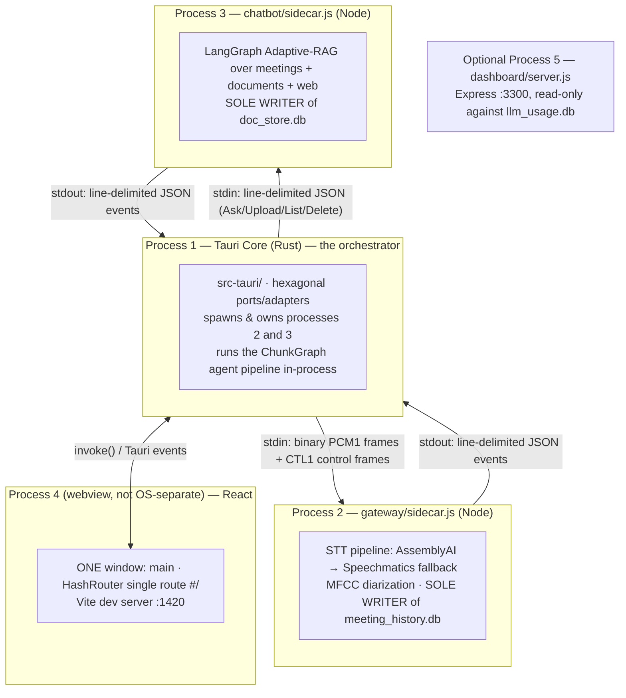
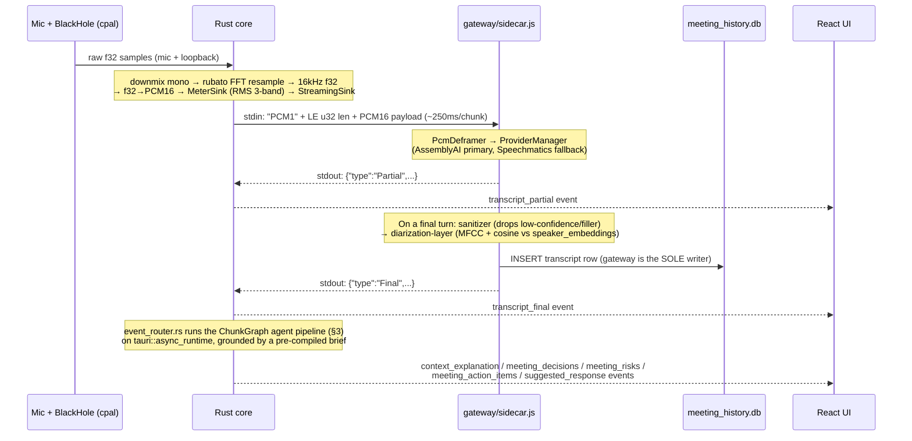
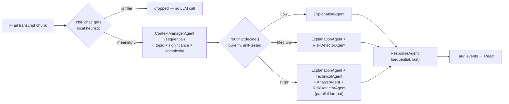
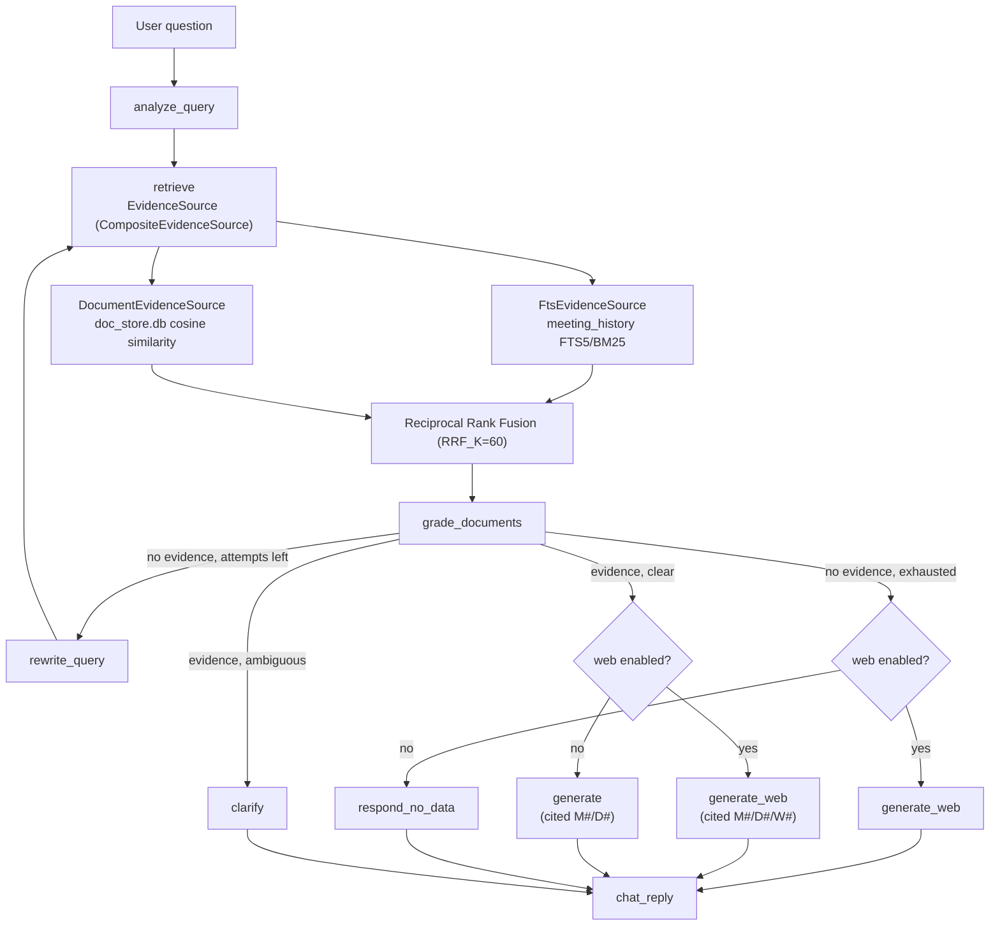

# Roxi — System Architecture

> **Scope:** Full process- and data-flow architecture of the Tauri v2 macOS desktop copilot that listens to live meetings, transcribes them in real time, and routes transcript chunks through a multi-agent LLM pipeline producing plain-language explanations, suggested replies, decisions, action items, and risks — plus a RAG+web chatbot over meeting history and uploaded documents, and a developer LLM-usage dashboard.
>
> **Tech stack:** Rust (Tauri 2, `cpal`, `rubato`, `rig-core`, `rusqlite`) · Node.js 20 (`better-sqlite3`, AssemblyAI/Speechmatics SDKs, LangGraph) · React 18 + TypeScript + Vite + Tailwind · SQLite ×3.
>
> Every claim in this document was re-verified against current source on **2026-09-15**. For the deeper file-by-file reference (including ADRs), see [`brain.md`](../brain.md). For focused deep dives, see [`docs/architecture/`](architecture/).

---

## 1. Process Architecture — 3 Concurrent Processes (+1 optional)

**IPC contract:**

- Rust ↔ Node sidecars: **stdio only** — binary/framed data in, line-delimited JSON events out. This is deliberately process-isolated; do not turn either pipe into a network socket.
- Rust ↔ React: **Tauri commands** (`invoke`, request/response) and **Tauri events** (`emit`/`listen`, push).
- The two Node sidecars never talk to each other or to the UI directly — Rust is the sole message broker between everything.

**Window topology** (`tauri.conf.json` + `lib.rs` `setup()`) — **a single window**, not the three-window toolbar/caption topology of earlier revisions of this document (that overlay tree was deleted from the frontend and never had corresponding window declarations in the current config):

| Label | Size | Route | Notes |
|---|---|---|---|
| `main` | 1180×760, min 480×520, **resizable** | `#/` | The entire app: idle screen → project library → live session (Suggest/Ask/Listen tabs) → history |

The window is **transparent** (native `NSVisualEffectView` vibrancy via `window_material.rs`, pinned to light appearance — not a CSS blur), **decorated** (normal traffic lights), and **not** always-on-top. Activation policy is `Regular` — the app has a Dock icon and a Cmd+Tab entry. `Option+Space` is a registered global shortcut that toggles show/hide; a tray icon (`roxi-tray`, Show/Hide/Quit) is the other way back if the window is hidden. None of this is "stealth" — there is no screen-capture shield and no fullscreen-float behavior in the current codebase (see §6).

---

## 2. End-to-End Audio → Insight Data Flow

Key file-level checkpoints:

- `src-tauri/src/adapters/mac_audio.rs` — `cpal` capture, mic + BlackHole loopback, downmixed to mono.
- `src-tauri/src/adapters/audio_meter.rs` — a transparent `PcmSink` decorator (`MeterSink`) that measures 3-band RMS and emits `audio_level` events (~31/sec) for the waveform UI, without opening a second audio stream in the webview.
- `src-tauri/src/resample.rs` — FFT sinc resample to 16 kHz.
- `src-tauri/src/streaming.rs` — PCM1 framing (`"PCM1"` magic + little-endian `u32` length + PCM16 payload).
- `src-tauri/src/adapters/control_channel.rs` — a second, `"CTL1"`-framed channel sharing the same stdin writer/lock, carrying control commands (`renameSpeaker`, `persistChunk`, `persistArtifacts`) so control traffic never blocks the audio hot path for long.
- `gateway/audio/pcm-deframer.js` → `gateway/stt/provider-manager.js` → `gateway/stt/transcript-sanitizer.js` → `gateway/stt/diarization-layer.js` → `gateway/control/command-handler.js` (handles the CTL1 side) → SQLite insert.
- `src-tauri/src/sidecar/event_router.rs` — deserializes each stdout line into a `SidecarEvent`; on `Final`, drives the agent pipeline.

**Ownership invariant:** the gateway sidecar is the **only** writer of `meeting_history.db`. Rust's `sidecar/persistence.rs` builds `persistChunk`/`persistArtifacts` *control commands* asking the gateway to write ChunkGraph output — it never opens the database for writing itself. This exists to avoid two processes fighting over one WAL file.

---

## 3. The Agent Pipeline (`ChunkGraph`)

Every agent call is composed from two halves (`agents/brief/compose.rs`):

- **Frozen system half** — a pre-compiled **context brief** (`agents/brief/compiler.rs`), one per agent, built once at `start_capture` from the active project's charter, glossary, roster, prior-meeting digests, open items, and uploaded-document extracts. Deterministically ordered and sentinel-wrapped so identical inputs hash identically — this is what lets an LLM provider's prompt-prefix cache actually hit.
- **Volatile user half** — the last few finalized turns (bounded `TranscriptWindow`, 8 turns / 600 chars each) plus the current chunk.

See [`docs/architecture/agent-pipeline.md`](architecture/agent-pipeline.md) for the full depth: the `Agent` trait, `LlmClient`/`OpenAiAdapter`, model tiering (`application/agent_registry.rs`), the brief compiler's budget/hashing model, and the dev-build contract assertion.

**Model tiering today:** both the fast tier and the "premium" tier resolve to `gpt-4o-mini` (`FAST_MODEL` / `PREMIUM_MODEL` in `agent_registry.rs`) — a deliberate, documented interim state, because the stronger model family's prompt-cache *write* cost can outweigh its read savings at typical per-meeting chunk counts. `PREMIUM_MODEL` is a single named constant specifically so this can be revisited without touching agent code.

---

## 4. Ask Roxi — Retrieval, Documents, and Web Search

Two independent axes reach this graph: `mode` (`rag`/`direct` — which corpora may be read, a UI toggle) and `webMode` (`auto`/`always`/`never` — whether the web tool is offered, config-only, no UI switch). `CHATBOT_WEB_SEARCH_MODE` defaults to `auto`, meaning **the model decides per turn whether to search** — there is no pre-classifier. `generate_web`/`web_answer` are therefore the normal production terminals; `generate`/`direct_answer` are the fallback used only when a search call fails or web is disabled.

See [`docs/architecture/ask-roxi-rag.md`](architecture/ask-roxi-rag.md) for the full depth: the `EvidenceSource`/`WebSearchGateway` port design, citation-ref assignment (`M#`/`D#`/`W#`), the document indexing pipeline, and failure/degradation policy per mode.

---

## 5. Databases

| Database | Sole writer | Read by |
|---|---|---|
| `gateway/meeting_history.db` | gateway sidecar | Rust (several read adapters), chatbot (read-only) |
| `gateway/llm_usage.db` | Rust + chatbot | dashboard, Rust's own usage command |
| `chatbot/data/chat_index.db` | chatbot (`FtsIndexBuilder`, wholesale rebuild) | chatbot (`FtsRetriever`, read-only) |
| `chatbot/data/doc_store.db` | chatbot | chatbot; Rust (`sqlite_document_source.rs`, **read-only**, feeds the brief compiler) |

Full schemas, migration policy, and the project-scoping columns are in [`docs/architecture/data-persistence.md`](architecture/data-persistence.md) and `brain.md`'s Database Schema section.

---

## 6. What Changed From Earlier Revisions of This Document

This document previously described a **three-window** topology (`main` / `toolbar` / `caption`), `Accessory` activation policy (no Dock icon), a fixed 420×780 always-on-top main window, and React 19. None of that matches the current codebase:

- The toolbar/caption windows and their overlay machinery were removed in an earlier frontend refactor and never existed as declared windows in the shipped `tauri.conf.json` — the dead command/capability surface referencing them has since been deleted outright.
- `src-tauri/src/macos_overlay.rs` (fullscreen float, `NSStatusWindowLevel`, `CanJoinAllSpaces`, and the screen-capture shield) has been **deleted from the repository**, not merely disabled. The app now runs `ActivationPolicy::Regular` (Dock icon visible) with a plain resizable window.
- Native window translucency moved from an implied CSS treatment to a dedicated `window_material.rs` module using real `NSVisualEffectView` vibrancy, because CSS `backdrop-filter` cannot sample the actual desktop behind a transparent OS window.
- The frontend is React 18, not 19, and Vite serves one route.

If a task references the old three-window design or "stealth" behavior, treat that as historical — confirm with the user before assuming any of it still exists, and check `brain.md`'s "Known Gaps & Stale Claims" table first.
