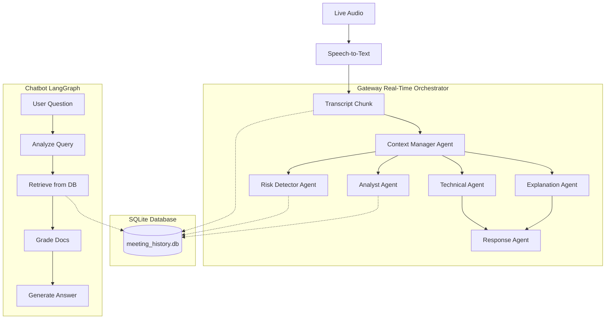

# Roxi-AI: Deep Dive into Agent Architecture & Flow

The Roxi-AI project utilizes a highly modular, multi-agent architecture divided into two entirely separate domains:
1. **The Gateway Agents** (Real-time meeting processing)
2. **The Chatbot Agents** (Post-meeting / On-demand RAG query processing)

Here is a full explanation of how data flows through each agent, what they do, and how they interact.

---

## 1. The Gateway Pipeline (Real-Time Orchestration Sequence)

The orchestration in Roxi is **static and deterministic**. The agents do not dynamically "talk to each other" or decide who speaks next. Instead, they are orchestrated in a strict, hardcoded sequence inside `agent-orchestrator.js` to guarantee the absolute lowest latency possible.

Here is the exact step-by-step lifecycle of a single audio chunk from the moment it arrives:

### Step 1: Validation & Chit-Chat Gate (Sequential)
When a chunk (e.g., `"Yeah, exactly."`) arrives:
1. The orchestrator validates the input.
2. It passes through a `chit-chat-gate`. If the chunk is just filler words or simple agreement, the orchestrator **stops processing immediately**. No LLM agents are triggered. This saves money and API calls.

### Step 2: Context Manager (Sequential)
If the chunk is substantive (e.g., `"Let's use PostgreSQL for the new database, but I'm worried about the migration costs by next Tuesday."`), the orchestrator triggers the **first agent**:
*   **`context-manager.js` (Runs Alone):** The orchestrator waits for this agent to finish. It reads the chunk and updates the global `meetingState` (Current Topic, Summary) and extracts new vocabulary.
*   *Why sequentially?* Because the next agents need to know the *current topic* to do their jobs accurately.

### Step 3: Deep Analysis Swarm (Concurrent / Parallel)
Once the Context Manager finishes, the orchestrator fires **four agents at the exact same time** using `Promise.all()`. They all read the same chunk and work simultaneously:
*   **`explanation.js`**: Analyzes the chunk to see if complex jargon needs to be explained to the user.
*   **`technical.js`**: Extracts purely technical architectural notes (e.g., "PostgreSQL selected").
*   **`analyst.js`**: Looks for decisions and action items (e.g., "Action: Migrate database. Deadline: Next Tuesday").
*   **`risk-detector.js`**: Checks for risks (e.g., "Risk: Migration costs").

*Why concurrently?* If each agent took 2 seconds to run sequentially, analyzing one chunk would take 8 seconds. By running them concurrently, all four agents finish in ~2 seconds total.

### Step 4: Synthesis & Response (Sequential)
Once all four parallel agents finish, the orchestrator takes the output from the Explanation and Technical agents and passes it into the **final agent**:
*   **`response.js` (Runs Alone):** It looks at the chunk, looks at the technical context extracted in Step 3, and decides if Roxi should prompt the user with a suggested reply, a clarifying question, or formalize a decision.

### Step 5: State Update & UI
The orchestrator collects the JSON outputs from all the agents, aggregates them into a single payload, updates the circuit breaker/billing trackers, and broadcasts the final result to the React frontend UI.

---

## 2. The Post-Meeting Generator

*   **Summary Generator (`generateMeetingSummary` in orchestrator)**: This isn't a continuous agent, but a final pass. When the meeting ends, a massive prompt is constructed containing the full conversation history, all the risks the `risk-detector` found, all the decisions the `analyst` found, and the glossary from the `context-manager`. A specialized LLM call then generates a polished, executive-level markdown summary.

---

## 3. The Chatbot Pipeline (On-Demand RAG)

Located in the `chatbot/` directory, this is an entirely separate system built using **LangGraph** (an Adaptive-RAG architecture). This system doesn't run automatically; it only runs when you type a question into the "Ask Roxi" panel in the UI.

### Flow of a Chatbot Query:
1.  **Analyze Query (`analyzeQueryNode`)**: Determines what the user is asking. Does it require looking up past meetings, or is it a general question?
2.  **Retrieve (`retrieveNode`)**: If it's about a meeting, it queries the local SQLite database (`meeting_history.db`) using Full-Text Search (FTS) to find relevant transcript chunks or summaries.
3.  **Grade Documents (`gradeDocumentsNode`)**: An agent reviews the retrieved database chunks. Are they actually relevant to the user's question? If not, they are discarded.
4.  **Rewrite Query (`rewriteQueryNode`)**: If the retrieved documents aren't good enough, this agent rewrites the user's prompt to be more search-friendly and triggers another search.
5.  **Generate (`generateNode`)**: Finally, an agent takes the perfectly curated database context and generates the final conversational answer for the user.

---

## Summary Diagram

