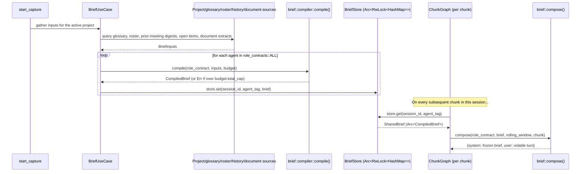
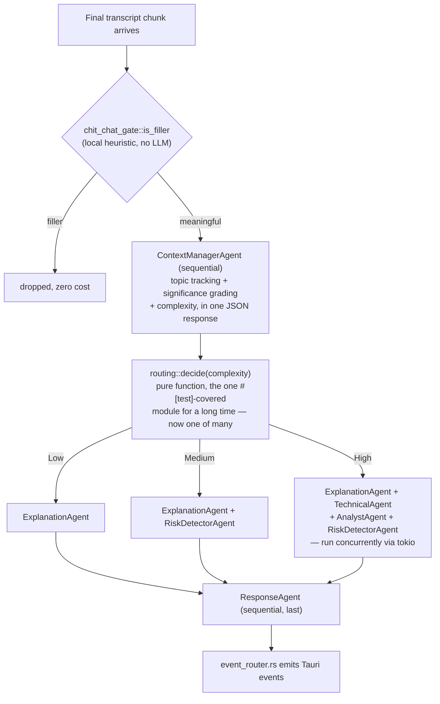

# Deep Dive: The Rust Agent Pipeline

> Covers `src-tauri/src/agents/` and `src-tauri/src/application/agent_registry.rs`. Read this after `docs/SYSTEM-ARCHITECTURE.md` §3 for the file-level mechanics behind the pipeline diagram. Every claim verified against source on 2026-09-15.

## 1. Why the agent pipeline lives in Rust, not Node

Earlier iterations of this app ran the LLM pipeline in the same Node process as STT. It was rewritten in Rust for one reason: `tokio` gives cheap, structured concurrency for the parallel fan-out stage (§3), and keeping it in the same process as the capture loop avoids a second IPC hop on the pipeline's hot path (every transcript chunk, not just user-initiated actions). The two Node sidecars that remain (`gateway/`, `chatbot/`) exist because their *dependencies* are Node-first — real-time STT SDKs and LangGraph — not because Node is a good fit for the agent graph itself. See `brain.md` ADR 1 for the full rationale.

## 2. `agents/` is a nested hexagonal slice, not a flat folder

```text
src-tauri/src/agents/
├── ports/          agent_port.rs (Agent trait), llm_port.rs (LlmClient trait)
├── domain/         chunk_state, decision, action_item, risk, agent_error, context_item, pipeline_trace
├── adapters/        openai_adapter.rs, openai_embedding_adapter.rs, usage_store.rs
├── agents/           context_manager, explanation, technical, analyst, risk_detector,
│                    response_agent, chit_chat_gate, complexity_analyzer (unwired), prompt.rs,
│                    role_contracts.rs
├── brief/            model, budget, compiler, compose, store   — see §4
└── orchestrator/     chunk_graph.rs, routing.rs
```

This mirrors the app-level `ports/`/`adapters`/`domain` split one level deeper, specifically so the agent pipeline can be reasoned about (and tested) independently of audio capture, window management, and the rest of the composition root.

## 3. The `Agent` trait and `LlmClient`

Every agent implements `ports::agent_port::Agent`. Every LLM call an agent makes goes through `ports::llm_port::LlmClient`, never an SDK directly — the one production implementation is `adapters::openai_adapter::OpenAiAdapter`, which wraps `rig-core`'s OpenAI client and is where per-call usage/cost logging to `llm_usage.db` happens (via `adapters::usage_store`), for both plain-text (`complete`) and JSON-extracting (`complete_json`) calls.

**`complete_json` is fragile by design**: it extracts JSON by taking the substring between the first `{` and the last `}` in the raw completion — no schema validation, no retry, no repair. This is a conscious trade rather than an oversight; it keeps the adapter dependency-free of a JSON-schema library. The corollary is that every JSON-producing prompt must be tightly constrained to "return only a JSON object" — a prompt that could plausibly emit nested unrelated braces or trailing prose will misparse silently.

## 4. Context briefs — the prompt-caching layer (`agents/brief/`)

A **brief** is a compiled, cacheable **system-prompt prefix**, one per agent, built once per meeting rather than re-sent on every chunk.



- **`model.rs`** — `BriefInputs`, `CompiledBrief`, `BriefManifest`, `SharedBrief = Arc<CompiledBrief>`.
- **`budget.rs`** — pure token accounting. Per-section ceilings under a `Budget` (default `total_cap: 5600`), a crude `estimate_tokens` (`len / 4`), and `take_within`/`clamp_to_budget`, which **never** emit a partial item or a partial sentence — an item is either fully included or fully dropped.
- **`compiler.rs`** — `compile(role_contract, inputs, budget) -> Result<CompiledBrief>`. Pure and deterministic: every section (project charter, glossary, roster, prior-meeting digests, open items, document extracts) is sorted deterministically before rendering, so identical inputs always produce a byte-identical string — this determinism is the entire point, since a provider's prompt-prefix cache only hits on byte-identical prefixes. The rendered string is wrapped in `<<<ROXI_BRIEF_V1>>> … <<<END_ROXI_BRIEF_V1>>>` sentinels and hashed (`hash_prefix`, sha256-16) as a cache/version key. Exceeding `budget.total_cap` returns `Err` rather than silently truncating — a misconfigured brief should fail loudly, not quietly starve an agent of context.
- **`compose.rs`** — `compose(role_contract, brief, rolling_window, chunk)` splits the final prompt into the frozen `system` half (the compiled brief, or the bare role contract if no brief exists yet) and a volatile `user` half (`--- LIVE SESSION ---` + the rolling window + the current chunk).
- **`store.rs`** — `BriefStore`: `RwLock<HashMap<SessionId, HashMap<AgentTag, SharedBrief>>>`, in-memory only, scoped to one capture, cleared on `stop_capture`.

**Why this exists:** without it, every agent call on every chunk would re-transmit the full grounding context (project charter, glossary, roster, history, documents) — expensive in tokens, and it defeats prompt-prefix caching because a re-serialized context blob is rarely byte-identical between calls even when its *content* hasn't changed. Compiling once and freezing the prefix turns that into a fixed, one-time cost per meeting per agent.

## 5. Model tiering (`application/agent_registry.rs`)

```rust
const FAST_MODEL: &str = "gpt-4o-mini";
const PREMIUM_MODEL: &str = "gpt-4o-mini"; // see in-code comment below
```

| Tier | Model | Agents |
|---|---|---|
| Fast | `gpt-4o-mini` | `context_manager`, `explanation`, `technical`, `analyst`, `risk_detector` |
| "Premium" | `gpt-4o-mini` (same model today) | `response_agent` only |

This is centralized deliberately — no agent hardcodes its own model string. The premium tier currently equals the fast tier because of a specific, documented cost consideration: the GPT-5.6 model family bills prompt-cache *writes* at a premium, and with relatively few chunks per meeting, that write cost can exceed what the cache saves on reads. `PREMIUM_MODEL` exists as a single named constant precisely so this tradeoff can be re-measured and flipped without touching any agent code. **When adding a new agent, register it here with a deliberate tier — don't default to premium.**

The tag passed to `OpenAiAdapter::with_tag` must equal the agent's `Agent::name()` exactly: it is simultaneously the usage-row tag in `llm_usage.db`, the `BriefStore` lookup key, and half of the prompt-cache key. A mismatch silently splits one agent's identity across two different tracked entities.

## 6. The graph: `ChunkGraph` and `routing::decide()`



`Complexity` (Low/Medium/High) is folded into `ContextManagerAgent`'s JSON response rather than being a separate sequential call — a deliberate savings of one round-trip per chunk. `agents/agents/complexity_analyzer.rs` still exists as a standalone module but is **intentionally unwired**: nothing constructs it today. Re-wire it in `agent_registry.rs` only if complexity ever needs its own model or cadence independent of the context manager.

Stage-2 routing exists to avoid running every agent on every chunk: `Low` complexity chunks (most small talk that survives the chit-chat gate, brief factual statements) only need an explanation; `High` complexity chunks (technical debates, ambiguous decisions) get the full fan-out. This is a direct, measured cost control, not a latency optimization alone.

## 7. Dev-build safety net

`agent_registry::initialize_agent_graph` calls `graph.assert_every_agent_has_a_contract()` after construction. This is a debug-build assertion that every agent dispatched by the graph has a corresponding entry in `agents::agents::role_contracts::ALL` — the list `BriefUseCase` iterates to compile briefs. Without this check, an agent added to the graph but forgotten in `role_contracts::ALL` would silently run **un-grounded forever**, with nothing in logs or the dashboard reporting it, since the LLM call would still succeed — just with an empty or fallback system prompt.

## 8. Adding a new agent — checklist

1. Implement `Agent` in `agents/agents/`.
2. Decide sequential (like `ContextManagerAgent`/`ResponseAgent`) vs. stage-2 parallel (like `ExplanationAgent`).
3. Add it as a field on `ChunkGraph` (`orchestrator/chunk_graph.rs`).
4. If stage-2, update `routing::decide()`.
5. Register an `OpenAiAdapter::with_tag(&api_key, <model>, "<tag>")` in `agent_registry.rs`, choosing `FAST_MODEL` or `PREMIUM_MODEL` deliberately.
6. Add it to `role_contracts::ALL` so the brief compiler covers it (the assertion in §7 will catch a miss in debug builds).
7. Emit its output as a new match arm in `event_router.rs`, plus the corresponding `IEventBus` method, `wireTypes.ts` shape, mapper, and consuming hook on the frontend.

Skipping step 6 produces a silent failure mode (§7); skipping step 7 produces output nobody in the UI ever sees. Both are easy to miss because the agent still "works" — it just doesn't count.
