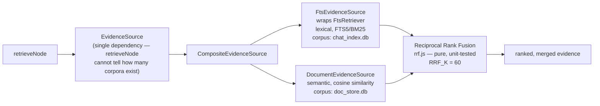
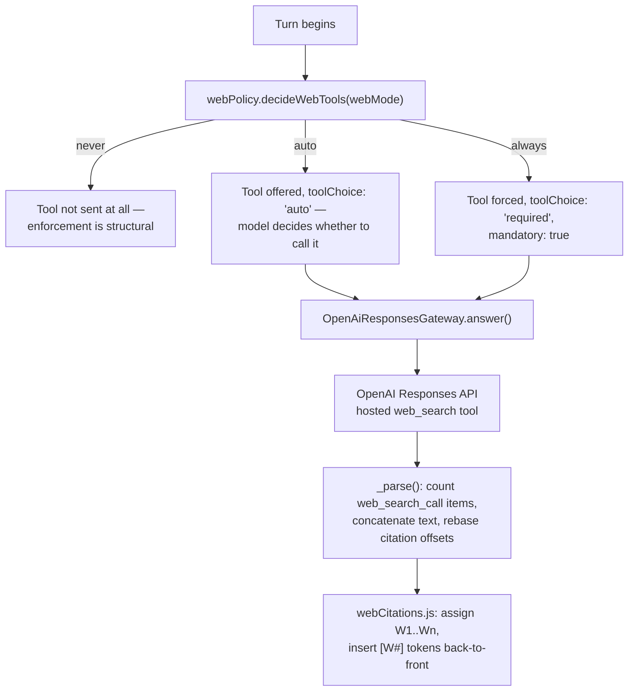

# Deep Dive: Ask Roxi — Retrieval, Documents, and Web Search

> Covers `chatbot/src/` end to end. Read `docs/SYSTEM-ARCHITECTURE.md` §4 first for the graph-level picture. Every claim verified against source on 2026-09-15.

## 1. Why this is a separate sidecar, not part of the Rust agent pipeline

"Ask Roxi" is on-demand (user asks a question) rather than continuous (every transcript chunk), and it depends on LangGraph, whose cyclic-graph-with-checkpointing ecosystem is Node/Python-first. Reimplementing that in Rust would mean reinventing a graph runtime for a single consumer. See `brain.md` ADR 1.

`invoke("ask_chat")` → `src-tauri/src/adapters/chat_client.rs` (`NodeChatClient`) spawns/talks to `chatbot/sidecar.js` over stdio JSON, mirroring how `adapters/gateway_client.rs` (`NodeGatewayClient`) manages the STT sidecar — the same process-lifecycle pattern, applied twice.

## 2. Two independent axes, not one

| Axis | Field | Values | Set by | Governs |
|---|---|---|---|---|
| Knowledge switch | `mode` | `rag` \| `direct` | UI toggle | Whether the user's own corpora (meetings, documents) are consulted at all |
| Web access | `webMode` | `auto` \| `always` \| `never` | Config only — `CHATBOT_WEB_SEARCH_MODE`, no UI switch | Whether a hosted web-search tool is offered to the model |

These are orthogonal on purpose: "Knowledge off" (direct mode) says nothing about whether the model may search the web, and a question like "how does our design compare to current industry practice" legitimately wants both retrieval *and* web access in the same turn. Conflating the two axes is the single most common way to get this feature wrong, per the project's own working notes — treat them as always independent when reasoning about a turn.

There is **no Web switch in the UI**. `TauriChatService` never sends `webMode` at all; an absent field defaults through `CHATBOT_WEB_SEARCH_MODE` (production default `auto`), applied once in `AnswerQuestionUseCase`. The graph's own internal default in `state.js` is `never` — this asymmetry is deliberate, so every pre-existing routing/graph test continues to pass unmodified. Because the LangGraph checkpointer's `lastWrite` reducer ignores an absent value on a later turn (it would otherwise silently inherit turn one's mode), `AnswerQuestionUseCase` must re-normalize `webMode` (and `mode`) on every single run, not just the first.

## 3. Retrieval — one port, two corpora, rank-fused

`EvidenceSource` is a **second port beside `Retriever`, not a widened `Retriever`** (`brain.md` ADR 2). `Retriever.search` takes sanitized FTS5 MATCH expressions that a vector search cannot consume, and `respondNoDataNode` still legitimately needs `Retriever.recentTopics()` — widening the interface would force every implementation to accept an argument it doesn't want (an ISP violation). `search()` receives both `question` and `matchExprs`; each adapter uses whichever it can.

**Failure isolation:** `CompositeEvidenceSource` treats a failing source as empty and logs it — a rate-limited embedding call or a missing document store must not take down meeting search.

**Cost guard:** `DocumentEvidenceSource` checks whether the document corpus is non-empty *before* embedding the question. With zero documents uploaded, it returns `[]` without billing a query embedding — otherwise every question on every install, forever, would pay for an embedding call that can never return a hit.

**Why rank fusion, not score arithmetic** (`brain.md` ADR 3): BM25-derived lexical scores are unbounded; cosine similarity is bounded 0..1. Adding them, or min-max normalizing per query, is unstable because the ranges shift with every question's specific term distribution. RRF (`application/retrieval/rrf.js`) uses **only rank**, making the merge scale-free and pure — it is kept in the same "pure, unit-tested" style as `orchestrator/routing.rs` (Rust) and `graph/routing.js` (JS).

## 4. Web search — a model decision, not a classifier

- **`domain/ports/WebSearchGateway.js`** — a narrow port beside `LlmGateway`, deliberately not a method on it (`brain.md` ADR 11 — same ISP/LSP reasoning as `EvidenceSource` beside `Retriever`, and the same reasoning that keeps `Retriever.search` from being widened). Contract: `answer(req) -> {answer, citations, usedWebSearch, searchCalls, latencyMs, model, usage}`; `model()`. Implementations **must reject on failure** rather than return an empty answer — the caller needs to distinguish "the model searched and found nothing" from "the search infrastructure was unreachable," because those two cases have different fallback behavior (§6).
- **`infrastructure/llm/OpenAiResponsesGateway.js`** — the only file that talks to `POST /v1/responses`. Sends **plain text only, never `response_format`**: URL citations returned by the API are character offsets into the response text, and wrapping the answer in a JSON envelope would make every offset address the wrong string. System messages become `instructions`; other turns become `input`. Retries up to twice on `{429,500,502,503,504}`/timeout with exponential backoff (400ms × 2^attempt). Has a one-time in-process fallback: if the API rejects the configured tool type with a 400 mentioning the tool as unknown/invalid/unsupported, it swaps to `web_search_preview` and retries without consuming a retry slot. Counts `web_search_call` output items directly to determine `usedWebSearch`/`searchCalls` — it never infers search use by scanning the returned prose. Maps `usage.input_tokens`/`output_tokens` onto `UsageRecorder`'s `prompt_tokens`/`completion_tokens`, or a web call would log zero cost against `llm_usage.db`.
- **`application/graph/webPolicy.js`** — pure. `normalizeWebMode(value)`: only `auto`/`always` pass through unchanged; anything else — including unset — becomes `never`. This is the **opposite default direction from `mode`** (which defaults to the more expensive `rag` path), and it's deliberate: an unrecognized web mode should fail closed (no tool), while an unrecognized knowledge mode should fail open (full retrieval) — the two features have different blast radii when misconfigured. `decideWebTools(webMode)` returns `{enabled, toolChoice, mandatory}` as shown in the diagram above.

## 5. Graph wiring — optional nodes, model-decided routing

`generate_web` and `web_answer` are added to the LangGraph **only if** the container supplies `generateWeb`/`webAnswer` functions — a container built with no web-search API key produces the exact same graph as before this feature existed. `routing.js`:

- `decideEntry(state)`: `mode !== 'direct'` → `rag` (the retrieval path, regardless of web). Otherwise (`direct`, "Knowledge off"), consults `decideWebTools(state.webMode).enabled` to choose `web_direct` (→ `web_answer`, falling back to `direct_answer` if unavailable) vs plain `direct`.
- `decideRoute(state)` (post-retrieval): no evidence + attempts remaining → `rewrite`; no evidence + attempts exhausted → `generate_web` if web is enabled, else `no_data`; evidence present + ambiguous → `clarify` (ambiguity is checked **before** the web branch — a genuinely unclear question gets clarified even if web access is available); evidence present + clear → `generate_web` if web enabled, else `generate`.

**The practical consequence:** with the production default (`CHATBOT_WEB_SEARCH_MODE=auto`), `generate_web` and `web_answer` are the **normal terminals** most turns land on — `generate` and `direct_answer` become the fallback path, used only when a web call fails or the container has no web-search key configured. The model can only decide to search if it's actually holding the tool; application config decides whether the tool is offered, never whether it's used.

**Do not add a search-or-not classifier.** It would reintroduce an `LLM → classify → LLM` round trip this design specifically avoids, and it would duplicate a decision the single Responses API call already makes for free. **Do not register web search into `CompositeEvidenceSource`** either — that array is searched on *every* RAG turn regardless of need, which both defeats "the model decides" and reintroduces the same wasted round trip from the other direction.

## 6. Failure policy — different per mode, on purpose

| `webMode` | On a failed/unreachable web call |
|---|---|
| `auto` | Degrades to the non-web twin (`generate`/`direct_answer`) with a `degradedNote` attached. |
| `always` | `web_answer` **refuses** rather than return an unsourced answer — the user explicitly asked for research mode, so a silent, uncited fallback would be worse than an honest failure. `generate_web`, however, still falls back to the retrieved evidence in this mode: a cited answer from the team's own records beats a refusal when there's evidence to cite. |

Never fabricate a search result under any mode.

## 7. Citations — refs assigned per answer, not per source

`meetingId` used to be the load-bearing citation token. Documents have no meeting, and web results have neither a meeting nor a document id, so rather than faking one for either:

- Every retrieved hit belongs to a **group** — one meeting, one document, or (on the web path) one URL — identified by a `groupKey` (`meeting:3`, `doc:abc`).
- Every group gets a **`ref`**: the token the model is asked to cite and the UI matches source cards against. Meetings keep `M<meetingId>` (so a meeting-only answer produces a byte-identical prompt to before this feature existed); documents get `D1, D2…`; web results get `W1, W2…` in first-seen order.
- **Refs are scoped to one answer, assigned at bounding time** (`boundEvidence` for `M#`/`D#`; `webCitations.assignRefs` for `W#`) — `D2` means "the second document *in this answer*," nothing more, nothing portable across answers.
- `GENERATE_SYSTEM` asks the model for `citedRefs: ["M3","D2"]` as structured JSON. `generateNode` also accepts the legacy `citedMeetingIds` field, mapped through `M<id>`, so an in-flight or old-shaped model response still resolves correctly.
- On the web path, the model **cannot** return a parallel JSON field (plain text only, per §4) — so `webCitations.readInlineRefs` scans the model's own prose for citation tokens it already wrote, and `insertWebRefs` inserts any the model omitted, back-to-front by descending offset so inserting one token never shifts an offset not yet processed. A citation whose character span is purely the provider's own inline markdown link is replaced outright by the `[W#]` token (avoiding a raw 60-character URL in the answer); a citation over real prose gets the token appended after it.
- **Source quota**: `MIN_GROUPS_PER_SOURCE_TYPE: 1` guarantees each contributing corpus at least one group in the answer, so one 200-chunk PDF can't occupy every slot within `MAX_EVIDENCE_GROUPS: 4`.
- `toSources` emits **different fields per source type** deliberately — meeting cards carry `meetingId`/`date`/`speaker`; document cards carry `docId`/`fileName`/`pageNumber`; web cards carry `url`/`title`/`snippet`. A padded, uniform shape would coerce a missing field (`Number(null)`) to `0` and render as a nonsensical "Meeting #0."

## 8. Follow-up chips — a text trailer, not JSON

`generate`'s structured JSON response can carry a `followUps` field directly. The web path can't — it returns plain text so citation offsets stay valid (§4) — so `infrastructure/llm/textResponse.js`'s `splitFollowUps` reads a trailing `FOLLOWUPS: a | b` line instead. It's checked **only on the last non-empty line** of the reply: a model that merely mentions the word "followups" mid-answer hasn't written a trailer, and truncating there would delete real answer content. Being a pure suffix, this convention also can't disturb any citation offset in the body above it. On the frontend, follow-up chips render in `src/features/chat/components/RoxiAnswerCard.tsx` and click through to `send()` in `ChatPane.tsx` — this is unrelated to the older, `suggest`-tab-specific `FollowUpRow` component (now replaced by `RefineRow`), which forwarded a label to the Ask tab rather than rendering a chip inline.

## 9. Document indexing pipeline

`IndexDocumentUseCase`: **validate → hash → parse → chunk → embed → store**, reporting progress at each phase via `DocumentProgress` events.

- **Validation runs before any row exists** — a rejected upload (unsupported extension, zero bytes, over the per-file or library byte cap) leaves no trace in the database.
- **Content is hashed (sha256) before insert.** `content_hash` carries a unique index; a `ready` duplicate returns the existing document and re-embeds nothing (free re-uploads). A non-`ready` duplicate (a prior upload that failed, or was killed mid-index) is deleted and re-indexed from scratch — otherwise one failed upload would permanently own that content hash.
- **Failures are recorded on the row** via `markFailed`; `list()` returns `status` + `errorMessage`, making the document list the only durable place to learn why an upload failed once any toast notification is gone.
- **Only `ready` documents are searchable** — `searchByVector` filters on status, so a half-indexed document never contributes to an answer.
- Chunking (`chunker.js`) is pure and char-based (2,000 chars ≈ 500 tokens, 256-char overlap), preferring paragraph → sentence → hard-cut boundaries in that order, and carries page numbers through the whole pipeline so a citation can say "p4."

## 10. Concurrency — two independent busy lanes

`stdioSidecar.js` keeps `askBusy` and `docBusy` as **separate** flags (`brain.md` ADR 6). A single shared flag would reject every question asked during a multi-second upload with `BUSY` — exactly the moment a user is most likely to ask about the document they just added. `better-sqlite3` is synchronous and the document store is its own physical file, so there's no write-interleaving hazard between the two lanes; each lock only serializes its own kind of request.

## 11. Rust's read-only involvement

Document upload/list/delete commands (`commands/documents.rs`) are thin forwarders — Rust starts (or reuses) a chat sidecar session and relays the corresponding stdin command (`UploadDocument`/`ListDocuments`/`DeleteDocument`); it does zero parsing, chunking, embedding, or writing itself. The **one** exception is `adapters/sqlite_document_source.rs`, which opens `doc_store.db` with `SQLITE_OPEN_READ_ONLY` purely so the Rust-side context-brief compiler (§ agent-pipeline.md) can pull document chunks directly, without a sidecar round trip on the capture-start path. The chatbot remains the exclusive writer of that database.
