# Deep Dive: Data & Persistence Architecture

> Three SQLite databases, deliberately never joined at the query level, each with exactly one writer. Every claim verified against source on 2026-09-15.

## 1. Why three separate files, not one

```mermaid
flowchart TB
    subgraph MH["gateway/meeting_history.db"]
        direction TB
        MHOwner["SOLE WRITER: gateway sidecar (better-sqlite3)"]
        MHReaders["Readers: Rust (rusqlite, several read-only adapters)<br/>chatbot (read-only, avoids WAL conflicts)"]
    end
    subgraph LU["gateway/llm_usage.db"]
        direction TB
        LUOwner["Writers: Rust usage_store.rs + chatbot UsageRecorder"]
        LUReaders["Readers: dashboard/, Rust's own get_session_usage command"]
    end
    subgraph CI["chatbot/data/chat_index.db"]
        direction TB
        CIOwner["Writer: chatbot FtsIndexBuilder — WHOLESALE REBUILD only"]
        CIReaders["Reader: chatbot FtsRetriever (read-only)"]
    end
    subgraph DS["chatbot/data/doc_store.db"]
        direction TB
        DSOwner["SOLE WRITER: chatbot (parse/chunk/embed/store)"]
        DSReaders["Readers: chatbot; Rust sqlite_document_source.rs (READ-ONLY,<br/>feeds the context-brief compiler)"]
    end
```



Each database has a different lifetime and a different single writer, and that separation is load-bearing, not incidental:

- `meeting_history.db` is written continuously, in real time, by a process (the gateway) that must never block on another process's lock.
- `chat_index.db` is periodically **rebuilt wholesale** by `FtsIndexBuilder` — putting anything with independent lifetime (like uploaded documents) in the same file would tie that data's survival to an index rebuild it has nothing to do with. This is exactly why documents got their own file (`brain.md` ADR 4) rather than living in `chat_index.db`.
- `llm_usage.db` is an append-mostly observability log with a completely different write pattern (one row per LLM/embedding/web-search call) than either of the above, and a different consumer (a dashboard, not the live app).
- `doc_store.db` has its own write pattern (batch inserts during indexing, occasional deletes) and its own consumer (semantic retrieval), independent of both the FTS index and meeting transcripts.

Two Node processes (gateway, chatbot) exist concurrently and both touch SQLite; **read-only opens are the concurrency-safety mechanism**, not application-level locking. The chatbot opens `meeting_history.db` read-only specifically to avoid WAL-mode write conflicts with the gateway, and Rust's `sqlite_document_source.rs` opens `doc_store.db` read-only for the identical reason relative to the chatbot.

## 2. `meeting_history.db` — schema and ownership

Written **only** by the gateway sidecar. Rust's `adapters/sqlite.rs` (`SqliteDatabase`) is the original read path for `get_meetings`/`get_meeting_details`; newer, narrower adapters were added alongside it rather than folded into it — `sqlite_projects.rs` (`ProjectRepository`), `sqlite_brief_source.rs` (`BriefSource` — glossary/roster/history/open items for the context-brief compiler), and `sqlite_usage.rs` (`SqliteUsageRepository`, actually reads `llm_usage.db`, not this file, despite living in the same adapters folder). `sqlite_schema.rs` holds shared schema-detection guards (`ensure_projects`, `has_table`, `has_column`, `meetings_are_project_scoped`) that all of the above use rather than each re-implementing schema probing.

```sql
CREATE TABLE meetings (
    id INTEGER PRIMARY KEY AUTOINCREMENT,
    start_time DATETIME DEFAULT CURRENT_TIMESTAMP,
    end_time DATETIME, context TEXT,
    status TEXT NOT NULL DEFAULT 'running',
    api_calls INTEGER NOT NULL DEFAULT 0,
    provider TEXT, summary TEXT
    -- plus project-scoping columns added for the Projects feature
);

CREATE TABLE transcripts (
    id INTEGER PRIMARY KEY AUTOINCREMENT,
    meeting_id INTEGER REFERENCES meetings(id),
    speaker TEXT, text TEXT,
    timestamp DATETIME DEFAULT CURRENT_TIMESTAMP
);

CREATE TABLE chunks (
    id INTEGER PRIMARY KEY AUTOINCREMENT,
    meeting_id INTEGER NOT NULL REFERENCES meetings(id),
    seq INTEGER NOT NULL, speaker TEXT, text TEXT NOT NULL,
    significance TEXT, topic TEXT,
    created_at DATETIME DEFAULT CURRENT_TIMESTAMP,
    UNIQUE (meeting_id, seq)
);

-- Extracted artifacts + speaker identity
CREATE TABLE decisions (...);         CREATE TABLE action_items (...);
CREATE TABLE risks (...);             CREATE TABLE technical_analyses (...);
CREATE TABLE suggested_replies (...); CREATE TABLE summaries (...);
CREATE TABLE glossary_terms (...);    CREATE TABLE speaker_profiles (...);
CREATE TABLE speaker_names (...);     CREATE TABLE speaker_embeddings (...);
```

Migrations are forward-only, in `gateway/db/migrate.js` — a shipped migration is never edited; a schema change is always a new migration file. This is a hard rule, not a preference: editing a shipped migration desyncs any install that already ran it from any that hasn't.

### How writes actually happen from Rust's side

Rust never opens `meeting_history.db` for writing. When the agent pipeline produces a decision, risk, action item, or the user renames a speaker, Rust's `sidecar/persistence.rs` builds a `persistChunk`/`persistArtifacts` (or `renameSpeaker`) **control command** and sends it to the gateway over the `CTL1`-framed control channel (`adapters/control_channel.rs`), sharing the gateway's stdin with the audio PCM1 stream but framed distinctly so a parser can tell them apart. `gateway/control/command-handler.js` receives these and performs the actual SQLite write. `sidecar/persistence.rs` also mints unique `chunk_ref`s (`c0`, `c1`, …) via an atomic counter, so two independent processing lanes (the fast reply-path wave and a detached risk/analyst wave) can attach their artifacts to the same logical chunk row without a race.

This module lives under `sidecar/`, not `adapters/`, specifically because it never touches SQLite directly — it is protocol-construction code for talking to a sidecar, the same category as `event_router.rs` and `chat_events.rs`.

## 3. `doc_store.db` — schema and ownership

Owned and written **exclusively** by the chatbot's document pipeline (parse → chunk → embed → store, see `ask-roxi-rag.md` §9).

```sql
CREATE TABLE documents (
    doc_id TEXT PRIMARY KEY, file_name TEXT NOT NULL, mime_type TEXT NOT NULL,
    byte_size INTEGER NOT NULL, page_count INTEGER,
    chunk_count INTEGER NOT NULL DEFAULT 0,
    embed_model TEXT NOT NULL,       -- provenance: re-embed if the model changes
    dimensions INTEGER NOT NULL,
    status TEXT NOT NULL,            -- indexing | ready | failed
    error_message TEXT, uploaded_at TEXT NOT NULL,
    content_hash TEXT NOT NULL,      -- sha256; dedupes re-uploads
    meeting_id INTEGER               -- RESERVED, unused: documents are global today
);

CREATE TABLE document_chunks (
    chunk_id TEXT PRIMARY KEY,
    doc_id TEXT NOT NULL REFERENCES documents(doc_id) ON DELETE CASCADE,
    chunk_index INTEGER NOT NULL, page_number INTEGER,
    char_start INTEGER NOT NULL, char_end INTEGER NOT NULL, text TEXT NOT NULL,
    embedding BLOB NOT NULL          -- Float32LE[dimensions], L2-normalized
);

CREATE UNIQUE INDEX idx_docs_hash ON documents(content_hash);
```

**Vectors are L2-normalized at write time**, which turns cosine similarity into a plain dot product at query time — no separate normalization step needed on every search. Brute-force search over a few thousand 1,536-dimension vectors runs in single-digit milliseconds, which is why there is no dedicated vector database in this stack; that decision should be revisited past roughly 50k chunks, not before.

**Document scope is deliberately global** (`brain.md` ADR 7): every uploaded document is searchable in every conversation, regardless of which meeting was live at upload time. The unused `meeting_id` column is a reserved escape hatch — scoping documents to a meeting later is one forward migration plus a filter in `DocumentEvidenceSource`, which is a strictly easier direction to move in than un-scoping a filter nobody wanted, silently hiding documents someone expected to find.

Rust's only interaction with this file is `adapters/sqlite_document_source.rs`, opened `SQLITE_OPEN_READ_ONLY`. Its own module comment states the ownership rule explicitly: the chatbot parses uploads, chunks them, embeds the chunks, and writes the rows — Rust's job here is retrieval only (`top_chunks` for cosine search, `chunks_for_documents` for direct fetch), feeding the context-brief compiler.

## 4. `chat_index.db` — the FTS5 layer

A wholesale-rebuilt full-text index over `meeting_history.db`, built by `FtsIndexBuilder` and read exclusively by `FtsRetriever` (opened read-only). Regenerate with `chatbot/bin/rebuild-index.js` — never hand-edit this file, since any manual change is erased on the next rebuild anyway. Because it's rebuildable from `meeting_history.db` at any time, it's treated as a derived artifact, not a source of truth — this is also why documents were never placed here (§ above, ADR 4).

## 5. `llm_usage.db` — the observability ledger

One row per LLM completion, embedding call, or web-search call — tag, model, status, latency, tokens, cost, and (unless `LLM_TRACK_PAYLOADS=0`) the actual prompt/response payloads. Written by Rust's `agents/adapters/usage_store.rs` and by the chatbot's own `UsageRecorder`, both independently, into the same file. Read by:

- `dashboard/` — the standalone LLM usage dashboard (`npm run dashboard`, port 3300).
- Rust's `adapters/sqlite_usage.rs` (`SqliteUsageRepository`, read-only) — backs the `get_session_usage` Tauri command and the frontend's `usage/UsagePill`.

A hosted web-search call is billed **per call**, separately from tokens — `cost_usd` alone under-reports a web-heavy session, which is why `webSearchCount` is logged as its own column rather than folded into a token-derived cost estimate.

## 6. Migration discipline

Both schema-evolution points in this system — `gateway/db/migrate.js` and `chatbot/src/infrastructure/documents/migrations.js` — are **forward-only**. The rule is simple and non-negotiable: never edit a shipped migration; add a new one. Editing history assumes every install re-runs migrations from scratch, which is false the moment any install has already applied the old version of a migration — at that point the two installs' schemas silently diverge with no error raised anywhere.
