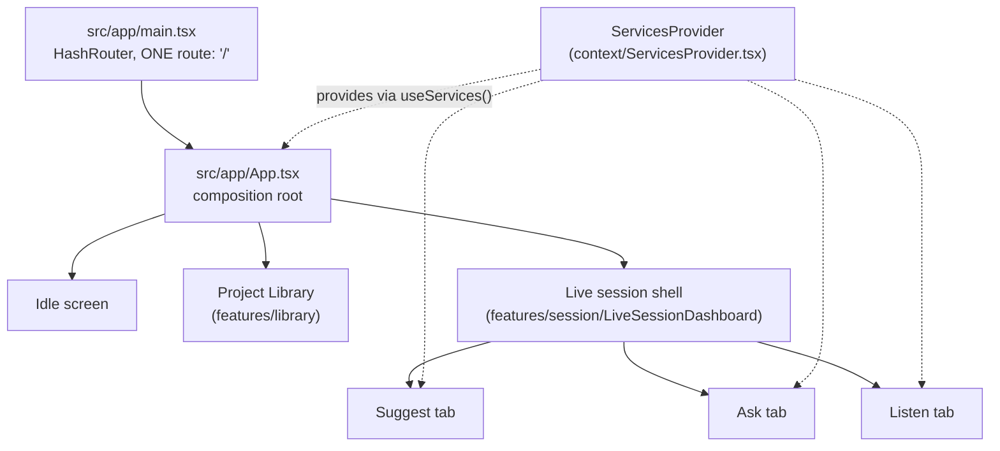
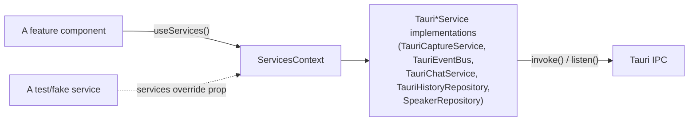

# Deep Dive: Frontend Architecture

> Covers `src/` — a single-window React 18 + TypeScript app. Every claim verified against source on 2026-09-15.

## 1. One window, one route, dependency-injected



There is exactly one Tauri window (`main`, 1180×760, resizable, transparent, decorated — see `docs/SYSTEM-ARCHITECTURE.md` §1). Two satellite windows (a floating toolbar, a click-through caption overlay) were planned and partially scaffolded in an earlier iteration; their components were deleted and their window declarations never existed in the shipped `tauri.conf.json`. The dead command/capability surface that referenced them (`commands/overlay.rs`, toolbar/caption capability files, `IEventBus.toggleToolbar`/`toggleCaption`) has since been removed outright. Reinstating either overlay is a from-scratch feature, not a re-enable — it needs a window declaration, a hash route, the component itself, a capability file, and a `setup()` re-navigation for dev mode (Tauri's dev server serves `devUrl` for every declared window and ignores each window's configured `url`, so a new window without that re-navigation would silently show the wrong route under `npm run tauri dev`).

## 2. Dependency injection over Tauri — never call `invoke()` from a component



Five service contracts live in `src/shared/interfaces/`: `ICaptureService`, `IEventBus`, `IChatService`, `IHistoryRepository`, `ISpeakerRepository`. Each has exactly one production implementation in `src/services/`, all Tauri-backed. `src/context/ServicesProvider.tsx` constructs all five **once** and exposes them via `useServices()` (`context/useServices.ts`) — components consume the interface, never the concrete class, and never call `invoke()`/`listen()` directly. `ServicesProvider` accepts a `services` override prop specifically so tests or a standalone harness can inject fakes without any component knowing the difference.

`src/services/mappers/` translates raw wire-format payloads (defined in `src/services/wire/`) into UI-facing types — this boundary is what keeps a backend event-shape change from rippling directly into component code; only the mapper needs to change.

## 3. Feature-folder organization

```text
src/features/
├── capture/        useCaptureSession (start/stop, status machine)
│                     wrapped by useCaptureFlow (adds ready → collecting-context → live)
│                     + useAudioLevel (audio_level event → waveform)
│                     + context-intake/ (meeting-context modal + presets)
├── transcript/      live transcript pane, speaker rename modal
├── suggest/          decisions/risks/actions/replies as filterable cards
│                     RefineRow (in-card refine-and-resend, replaces the deleted FollowUpRow)
├── chat/              "Ask Roxi" — ChatThreadProvider + useChatThread, RoxiAnswerCard/SourceChip/
│                     ThinkingIndicator/UserBubble — renders follow-up chips independently of suggest/RefineRow
├── session/           LiveSessionDashboard + LiveStage — the live-capture shell wrapping the 3 tabs
├── library/            ProjectLibrary/ProjectList/ProjectDetail — the multi-project meeting browser
├── usage/              UsagePill — reads get_session_usage
├── analysis/           AnalysisPane
├── history/             HistoryPane, MeetingDetailModal — past-meeting browser
└── history-chat/        empty directories only — dead, nothing imports it
```

Each feature owns its own hook(s) that call `useServices()` and its own presentational components — there is no shared global store; state is scoped to the feature that needs it. `App.tsx` is a thin composition root: it renders the idle screen, the project library, or the live session shell, and wires `useCaptureFlow` + the chat context together. Navigation and flow rules live in the hooks, not in `App.tsx` itself — a hook like `useCaptureFlow` is the single place that knows the ready → collecting-context → live sequence.

**`RefineRow` vs. the deleted `FollowUpRow`:** an earlier design forwarded a follow-up label from a Suggest card over to the separate Ask tab. `RefineRow` replaced this with an in-card refine-and-resend action that acts on the card it sits in, rather than forwarding a label elsewhere — a more direct interaction for the same underlying need. `FollowUpRow.tsx` was deleted once nothing imported it; the *chat pane's own* follow-up chips (rendered by `RoxiAnswerCard`, driven by `message.followUps` from the sidecar's `chat_reply` payload) are unrelated to this and were never removed.

## 4. Design system — build blocks, not ad hoc `div`s

`src/design-system/` holds shared visual primitives: `GlassCard`, `Badge`, `TagChip`, `Waveform`, `SignalRing`, `Tooltip`, `ContextRow`, icons, `tokens.ts`, `tagPalette.ts`. New UI should compose from these rather than hand-rolling styled containers — this is what keeps the glass shell's opacity budget (§5) consistent across features that were built at different times.

`src/design-system/markdown/` renders the light markdown model answers come back as: `parse.ts` is pure and independently testable, `Markdown.tsx` builds the React element tree, `CodeBlock.tsx` adds the language label and copy button. This is a deliberately hand-written renderer rather than a markdown library dependency, for three concrete reasons: the prompts already restrict model output to bullets/bold/inline-code/fences, so a general-purpose parser buys nothing; a real markdown library would add well over 100KB to the bundle against this implementation's roughly 7.4KB; and the chat's citation tokens (`[M24]`, `[W1]`) need to interleave with inline formatting regardless of which renderer is used, so the integration work doesn't disappear even with a library. It never builds an HTML string — no `dangerouslySetInnerHTML`, no sanitizer to maintain. The chat feature passes its citation resolver in via a `renderText` prop, which is what keeps chat-specific concepts (what a `[M24]` token means) out of the design system itself. One deliberate quirk: `_underscores_` are **not** rendered as italics, because this app's answers are full of `snake_case` identifiers that would otherwise be mangled.

## 5. Window transparency — native material, not CSS blur

The window is see-through, and the layer that makes that readable is **native, not CSS**. Three things have to stay true together (see `brain.md`'s "Window transparency" / `window_material.rs` sections for the Rust side):

- `app.macOSPrivateApi: true` plus the `macos-private-api` Tauri Cargo feature — without both, `transparent: true` is silently ignored on macOS.
- `src-tauri/src/window_material.rs` installs a real `NSVisualEffectView` behind the webview and pins the window to Aqua (light) appearance. It's a no-op off macOS, deliberately — a transparent window with no material behind it would put UI text directly onto the user's desktop.
- The appearance pin is load-bearing: Roxi's palette is light-only with near-black text, and macOS materials otherwise follow the system appearance — under Dark Mode, an unpinned window would render the material dark and the text would become unreadable.

`--glass-alpha` (currently `0.30` in `src/styles.css`) is a **tint over that native material**, not a surface of its own — it's the one value meant to be tuned by eye. `--t-shell-backdrop` is `none`, and **must stay that way**: `backdrop-filter` can only sample the backdrop *within the page*, and the desktop is not part of the page, so a CSS blur there would cost a full-window rendering pass every frame for zero visible effect. Every surface inside the shell is either transparent or a white overlay at ≤ 0.06 alpha — nested opaque panels are what turn a glass effect into grey soup. Sheets that sit *over* the glass (modals, tooltips) are the deliberate exception: they carry their own readable ground rather than deriving from `--glass-alpha`, because the text behind them would otherwise show through.

`decorations` stays `true` — there is no close/minimize control anywhere in `src/`, so removing decorations would leave the traffic lights gone and the tray icon as the only way to quit. `titleBarStyle: "Transparent"` (rather than `"Overlay"`) was chosen for a related reason: `Overlay` gives a full-size content view with the traffic lights floating on top of whatever occupies the app's top-left corner, which this layout doesn't want.

## 6. Events in, state out

`TauriEventBus` (`src/services/TauriEventBus.ts`) implements `IEventBus` and is the single subscription point for every Tauri event listed in `docs/SYSTEM-ARCHITECTURE.md`/`brain.md`. Each feature's hook (`useTranscript`, `useSuggestAnswers`, `useAudioLevel`, `useChatThread`, `useUsage`, …) subscribes to exactly the events it needs and owns its own slice of state — there is no central reducer aggregating every event type. Changing an event's shape is always a three-file, in-lockstep change: `src-tauri/src/sidecar/events.rs` (the payload struct), `event_router.rs` (the match arm that turns it into a Tauri event), and the frontend (`IEventBus` + the concrete `TauriEventBus` method + `wireTypes.ts` + the mapper + the consuming hook). Skipping any one of the three produces a payload the other two sides disagree about the shape of, which fails silently at the JSON boundary rather than at compile time.
