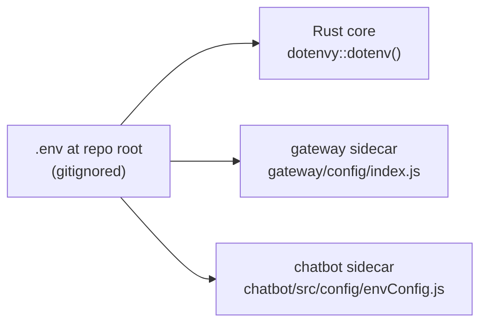

# Deep Dive: Security, Configuration & Operational Posture

> A consolidated view of environment configuration, secret handling, the standing security audit, and what's actually load-bearing vs. cosmetic in the current codebase. Every claim verified against source on 2026-09-15.

## 1. Configuration model — one root `.env`, read by three runtimes

All three runtimes read the **project-root** `.env`, not a per-subproject one — both Rust (`dotenvy::dotenv()` in `lib.rs`) and each Node sidecar fall back to their own local `.env` only if the root file doesn't supply a value. This matters specifically for a packaged `.app` bundle: it does not inherit the developer's shell environment the way `npm run tauri dev` does, so a key that only exists in a shell profile silently disappears in production. Each sidecar has exactly one module responsible for reading `process.env` — `gateway/config/index.js` and `chatbot/src/config/envConfig.js` respectively — so environment handling isn't scattered across files that each parse a subset of variables differently.

### Required

| Variable | Consumed by | Failure mode if missing |
|---|---|---|
| `OPENAI_API_KEY` | Rust agents, chatbot LLM + embeddings + web search | `agent_registry.rs` logs a `[FATAL]` error at startup but does **not** crash the process; every subsequent agent call then fails with a 401. |
| `ASSEMBLYAI_API_KEY` / `SPEECHMATICS_API_KEY` | gateway STT | At least one is required; the gateway will not have a working transcription provider without either. |

### Everything else has a working default

The full variable table (capture pipeline, Ask Roxi/documents, web search, observability/privacy) is maintained in one place to avoid drift between documents — see `README.md`'s [Configuration](../../README.md#-configuration) section and `brain.md`'s Environment Variables section, both kept in sync with `chatbot/src/config/envConfig.js` and `gateway/config/index.js` as the source of truth.

## 2. Secret handling

- `.env` is gitignored; `.env.example` documents every variable's name and purpose with placeholder values, never real keys.
- The Husky `pre-commit` hook (`.husky/pre-commit`) blocks any staged `.env`/`.env.local` file outright, greps the diff for obvious API-key patterns (`ASSEMBLYAI_API_KEY=`, `SPEECHMATICS_API_KEY=`, `OPENAI_API_KEY=sk-...`), and runs `npx tsc --noEmit` before allowing a commit. Bypassing it with `--no-verify` should be treated as an explicit, user-requested exception, not a default workaround for a failing hook.
- `LLM_TRACK_PAYLOADS=0` is the privacy toggle for `llm_usage.db`: with it set, prompts and responses are not persisted alongside the token/cost/latency metrics that are always recorded. Default is `1` (payloads stored) — worth knowing before treating the usage database as safe to share broadly.

## 3. Standing audit findings (`audit/CODE-AUDIT-REPORT.md`, 2026-08-26)

| Severity | Count | Examples |
|---|---|---|
| Critical | 1 | API keys stored in plaintext (`.env` files) |
| High | 4 | CSP disabled (`security.csp: null`), `withGlobalTauri: true`, sidecar spawn path derived from CWD, unauthenticated stdin protocol between Rust and the sidecars |
| Medium | 8 | Mutex panics, unbounded channels, resampler flush edge cases, fragile DB path resolution, O(n) deframer resync scan, flush-timer race, type confusion |
| Low | 9 | Misleading names, unused dependencies, logger not initialized in some paths, dead code, hardcoded limits |

**This report is a point-in-time snapshot and is explicitly stale in places** — several of its LLM/agent-architecture findings predate the migration of the agent pipeline from Node to Rust, and its window-related findings predate the removal of the macOS overlay subsystem described in `docs/SYSTEM-ARCHITECTURE.md` §6. Treat every individual finding as a hypothesis to verify against current source, not a standing fact — this document and `brain.md`'s "Known Gaps & Stale Claims" table are where verified corrections live.

### Outstanding, still true as of this revision

1. **Rotate any key that was ever committed to git history.** A key that touched a commit, even one later removed, should be treated as compromised regardless of whether the file is gitignored now.
2. **`security.csp` is still `null`** in `tauri.conf.json`. No Content Security Policy is enforced on the webview.
3. **`withGlobalTauri` is still `true`.** Verified 2026-09-07 (and unchanged since): `window.__TAURI__` is referenced **nowhere** in `src/` or `index.html` — the window-control code that once needed it went with the deleted `TopBar.tsx`. This means the flag can be turned off with no functional impact, but it hasn't been yet; it's queued behind packaging work rather than treated as a drive-by change.

**Don't assume CSP protections exist anywhere in the frontend.** Any new code that would rely on CSP to constrain script sources, inline execution, or `eval` must not be written on that assumption — the policy is currently `null`, meaning unrestricted.

## 4. Process-isolation as a security boundary, not just an architecture choice

The Rust ↔ Node sidecar boundary (stdio pipes, never sockets) is called out repeatedly across this project's documentation as **deliberate** — worth restating here in security terms specifically: a sidecar's stdin/stdout is only reachable by the parent process that spawned it, with no listening port to scan, no network-adjacent attack surface, and no risk of another process on the machine connecting to it. Turning either pipe into a network socket (even bound to localhost) would trade this property away for no architectural benefit, since both sidecars are only ever meant to be reached by the one Rust process that owns their lifecycle. This is why the audit's "unauthenticated stdin protocol" finding (§3) is medium-severity in practice rather than critical — the protocol has no authentication, but it also has no network reachability to authenticate against.

## 5. What "stealth" security properties no longer apply

Earlier revisions of this codebase's documentation described screen-capture invisibility (`set_content_protected`) and a fullscreen-float/no-Dock-icon posture as active security/privacy properties of the app. As of this revision, **none of that code exists** — see `docs/SYSTEM-ARCHITECTURE.md` §6 for the full removal history. If a threat model or security review references "the app is invisible to screen sharing" as a mitigating control, that claim is false against the current codebase and should be corrected rather than assumed.

## 6. Cost- and abuse-control surfaces (adjacent to, but distinct from, security)

Not security controls in the traditional sense, but part of the same "don't let an external, only-partially-trusted input cause unbounded resource consumption" posture:

- `LLM_BUDGET_SOFT`/`LLM_BUDGET_HARD` — a circuit breaker capping LLM calls per capture session.
- `ANOMALY_COST_PER_CHUNK_USD`/`ANOMALY_COST_PER_MIN_USD`/`ANOMALY_SESSION_BUDGET_USD` — cost-anomaly detection independent of the hard call-count breaker.
- `CHATBOT_LLM_BUDGET_SOFT`/`_HARD`, `CHATBOT_EMBED_BUDGET_HARD`, `CHATBOT_WEB_BUDGET_HARD` — three **separate** budgets for the chatbot's own completions, embeddings, and web-search calls respectively, so that a large document upload (many embedding calls) or a research-heavy conversation (many web searches) cannot silently exhaust the budget that governs ordinary question-answering.
- `CHATBOT_MAX_DOCUMENT_BYTES`/`CHATBOT_MAX_LIBRARY_BYTES`/`CHATBOT_MAX_DOCUMENTS` — hard caps on the uploaded-document surface, checked before any row is created (see `docs/architecture/ask-roxi-rag.md` §9).

Every one of these exists because an LLM- or search-backed feature has effectively unbounded downstream cost per call; the budgets are the mechanism that keeps a single session, upload, or research question from being able to run up an unbounded bill.
